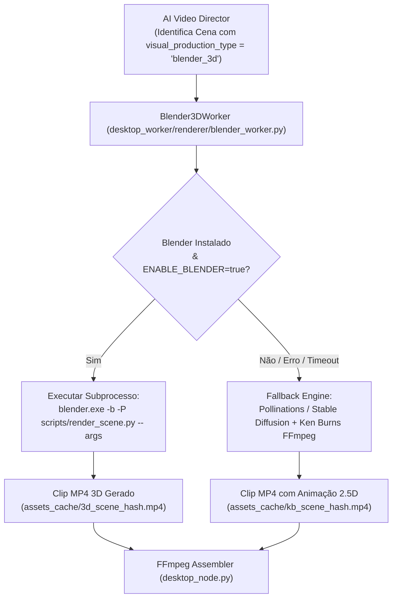

# ARQUITETURA DE INTEGRAÇÃO BLENDER HEADLESS (FASE 1)
## Dark Channel Factory — Cinematic Production Engine

---

## 1. VISÃO GERAL

O módulo Blender é projetado como um **worker independente e desacoplado**, que não bloqueia nem substitui o renderizador principal do sistema. Sua finalidade é produzir planos 3D cinematográficos sob demanda para tomadas específicas (cenas chave, introduções, gráficos isométricos e mapas geopolíticos).

---

## 2. REGRAS DE ISOLAMENTO E NÃO-OBRIGATORIEDADE

1. **Zero Dependência Obrigatória:** O pipeline de produção continuará funcionando 100% caso o Blender não esteja instalado na máquina hospedeira.
2. **Worker Independente:** O processo executa via CLI headless (`blender -b -P render_script.py -- [args]`) em subprocesso ou fila separada.
3. **Preservação do Worker Principal:** O `desktop_node.py` não foi modificado para depender do Blender.
4. **Fallback Transparente em Cascata:**
   - **Nível 1 (Blender Disponível):** Renderiza cena 3D programática em background (Cycles ou Eevee).
   - **Nível 2 (Fallback IA/Ken Burns):** Gera imagem cinematográfica e aplica transição Ken Burns dinâmica com zoom e pan suaves.
   - **Nível 3 (Fallback Procedural):** Gera gradiente dinâmico com expressões matemáticas FFmpeg (`geq`).

---

## 3. DIAGRAMA DA INTEGRAÇÃO FUTURA (FASE 4)



---

## 4. CONTRATO DE INTERFACE PROGRAMÁTICA

A interface é implementada em `desktop_worker/renderer/blender_worker.py`:

```python
class Blender3DWorker:
    def is_available(self) -> bool:
        """Verifica se o binário do Blender está acessível no host."""
        ...

    def render_3d_shot(self, scene_contract: dict, output_path: str) -> Optional[str]:
        """
        Renderiza tomada 3D. Se o Blender não estiver disponível, 
        aciona o fallback de forma transparente.
        """
        ...
```

---

## 5. VARIÁVEIS DE AMBIENTE (FEATURE FLAGS)

- `ENABLE_BLENDER_RENDER`: `false` (padrão nesta Fase 1).
- `BLENDER_EXECUTABLE_PATH`: Caminho explícito opcional para `blender.exe`.
- `BLENDER_RENDER_TIMEOUT_S`: Tempo limite por cena (padrão: 60s).
