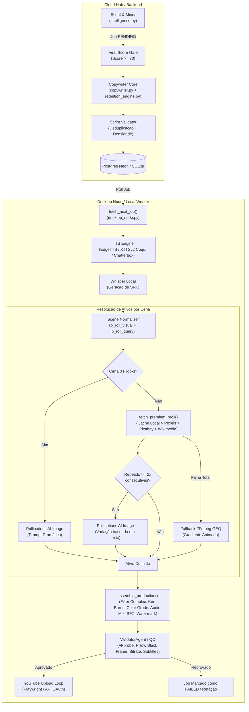
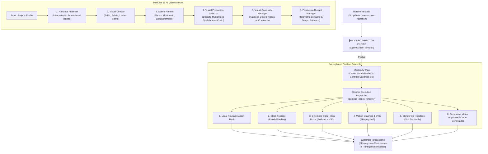
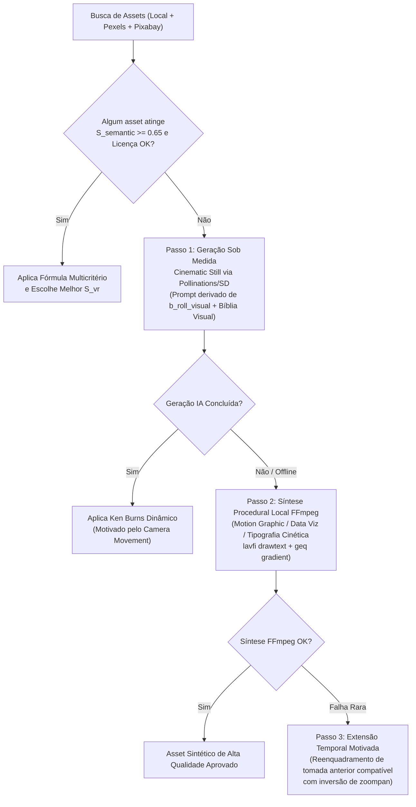
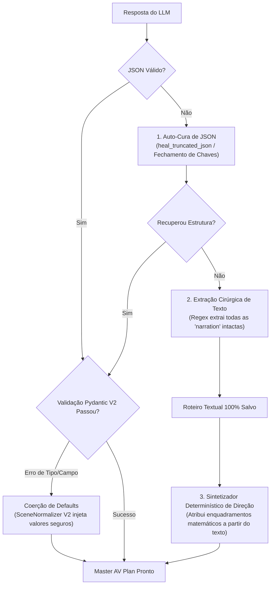

# DARK CHANNEL FACTORY — ARQUITETURA FASE 2: AI VIDEO DIRECTOR
**Documento de Diagnóstico, Especificação Arquitetural e Roadmap de Evolução**  
**Versão:** 1.3.0 (Sprint 2.1 Concluído e Homologado: Contrato Canônico V2, Normalização Determinística, Imutabilidade e Retrocompatibilidade Integral)  
**Data:** 02 de Novembro de 2026  
**Status:** Sprint 2.1 Concluído e Homologado (108 Testes Aprovados — 83 Fase 1 + 25 Sprint 2.1)  
**Ambiente Alvo:** Arquitetura B (Desktop Node / Local Worker + Cloud Hub / SQLite / Postgres Neon)

---

## 1. RESUMO EXECUTIVO

O **Dark Channel Factory** concluiu sua Fase 1 com sucesso, consolidando a padronização por perfis de produção (`PILOT_5MIN`, `STANDARD_10MIN`, `DOCUMENTARY_20MIN`, `SHORTS`) e 83 testes automatizados aprovados com 100% de integridade e isolamento estrito de dados.

Contudo, a auditoria diagnóstica demonstrou que o pipeline atual funciona primariamente como um **associador superficial de palavras-chave a clipes de estoque (B-roll keyword matcher)**. As decisões visuais são dispersas entre o prompt do roteirista (`cloud_hub/core/copywriter.py`) e heurísticas ad-hoc no renderizador desktop (`desktop_node.py`), tais como a escolha aleatória de zooms Ken Burns (`random.choice(["in", "out"])`) e a geração de imagens de IA apenas de forma reativa quando o mesmo clipe se repete consecutivamente.

A **Fase 2 (AI Video Director)** estabelece a camada de inteligência e direção audiovisual da fábrica. A versão **1.2.0** deste documento incorpora a consolidação técnica final exigida antes do início de implementação:

1. **Unificação do Contrato Canônico V2:** Erradicação de divergências de nomenclatura entre o JSON Schema V2, o modelo Pydantic `Scene`, o `shared/scene_normalizer.py` e o pipeline operacional legado de `desktop_node.py`. Definição de tabela canônica de campos, obrigatoriedade, tipos, defaults e mapeamentos bidirecionais explícitos.
2. **Formalização do Algoritmo Multicritério:** Escala de normalização unificada ($[0.0, 1.0]$), fórmula matemática de aptidão visual, normalização de custo por teto de perfil, regras de desempate determinísticas e cadeia de contingência (*Fail-Safe Fallback Chain*) para garantir que nenhum asset inadequado seja selecionado apenas para preencher espaço.
3. **Formalização da Avaliação Semântica ($S_{\text{semantic}}$):** Diferenciação formal dos 5 tipos de relação áudio-visual (direta, contextual, metafórica, documental e desconexão/dissonância). Cálculo na v1 baseado em métodos determinísticos locais de baixo custo (IDF ponderado, embeddings densos compactos em CPU e regras de domínio temporal), sem chamadas multimodais obrigatórias por cena.
4. **Licenciamento Individual e Rastreabilidade (`AssetMetadata`):** Metadados auditáveis por asset (provedor, identificador/URL canônica, licença, evidência jurídica, exigência de atribuição, data e hash SHA-256), com rejeição mandatória de itens de uso estritamente editorial em vídeos monetizados.
5. **Harmonização dos Veto Gates e Prevenção de Falsos Positivos:** Distinção de 4 níveis de intervenção (`CONTINUITY_ALERT`, `AUTO_CORRECTION`, `AV_PLAN_REJECTION`, `RENDERED_QC_REJECTION`). Definição matemática de variação temporal de fluxo ótico para que Ken Burns procedural e motion graphics não sejam classificados falsamente como telas estáticas. Harmonização dos limites de enquadramento consecutivo (atuação preventiva no 3º; veto estrito em $>3$).
6. **Critérios Definitivos de Aceite do Sprint 2.1:** Matriz objetiva de aprovação para a primeira entrega incremental.
7. **Salvaguardas de Implementação:** Garantia incondicional de não-descarte de roteiros textuais, reconstrução determinística de planos visuais, retrocompatibilidade com os 83 testes da Fase 1 e preservação de `desktop_node.py` sem reescritas.

---

## 2. DIAGNÓSTICO DA ARQUITETURA ATUAL

### 2.1 Coexistência das Arquiteturas A e B

O repositório apresenta duas vertentes arquiteturais:

1. **Arquitetura A (Distribuída / Redis / RQ):**
   - Composta por agentes isolados em `agents/copywriter/`, `agents/video_editor/`, `agents/designer/`, `agents/validator/` e `orchestrator/`.
   - Orientada a filas de tarefas assíncronas com Redis. O `agents/video_editor/agent.py` monta o vídeo de forma genérica via `media_fetcher.py` e `video_assembler.py`.
   - **Diagnóstico:** Permanece como suíte de homologação de componentes e referência modular, mas **não** é o ambiente operacional de produção diária.
2. **Arquitetura B (Operacional / Desktop Node / SQLite + Neon PG):**
   - Centrada em `desktop_node.py` (2.669 linhas) e no `cloud_hub/` (`main.py`, `core/copywriter.py`, `core/intelligence.py`).
   - O worker desktop faz polling dos jobs, sintetiza narrações neurais locais/cloud, transcreve com Whisper, resolve B-rolls e SFX, sintetiza código ou gráficos via PIL, gerencia aceleração de hardware (Intel QSV, NVENC ou CPU) e monta o arquivo final com filtros complexos do FFmpeg.
   - **Diagnóstico:** **É a arquitetura de produção real e homologada.** Deve ser estritamente preservada. O AI Video Director deve injetar inteligência de planejamento desacoplada sem inflar o `desktop_node.py`.

---

## 3. MAPA DO PIPELINE OPERACIONAL ATUAL



---

## 4. PROBLEMAS E OPORTUNIDADES IDENTIFICADOS

| ID | Componente Afetado | Diagnóstico Técnico | Impacto na Qualidade Audiovisual |
| :--- | :--- | :--- | :--- |
| **P-01** | `cloud_hub/core/copywriter.py` | As cenas são geradas com campos `narration` e `b_roll_visual` puramente textuais. A IA não expressa plano cinematográfico (close-up, wide, tracking shot), intenção dramática nem tipo de ativo recomendado. | O renderizador recebe um texto e tenta adivinhar o que exibir via busca genérica de palavras-chave. |
| **P-02** | `desktop_node.py` (linhas 2125-2224) | A lógica de seleção visual é puramente heurística: apenas a Cena 0 (Hook) recebe tratamento especial via Pollinations; cenas seguintes tentam Pexels/Pixabay e só geram imagem de IA se a mesma mídia foi repetida 2 vezes seguidas. | Vídeos longos (36 a 90 cenas) sofrem de dissonância visual: clipes ultrarrealistas misturados com ilustrações 2D sem coerência estética. |
| **P-03** | `desktop_node.py` (linhas 1645-1688) | Todos os vídeos e imagens recebem tratamento uniforme de câmera: vídeos recebem escala estática `scale+crop` e imagens recebem Ken Burns procedural (`zoompan` aleatório com `random.choice(["in", "out"])`). | O movimento de câmera não é motivado pela narrativa. Cenas de tensão recebem o mesmo movimento que cenas de dados ou resolução. |
| **P-04** | `shared/models.py` | O modelo `Scene` possui apenas `b_roll_query`, `b_roll_visual`, `sfx_cue`, `visual_cues` e `on_screen_text`. Não há campos formais canônicos para enquadramento, movimento de câmera, estilo de arte, transição nem categoria de produção visual. | Ausência de contrato unificado impede agentes de direção de comunicarem intenções refinadas ao motor de montagem. |
| **P-05** | `desktop_node.py` | Tamanho monolítico (2.669 linhas). Novas lógicas de IA de direção adicionadas diretamente nele aumentam brutalmente o risco de regressão nos fluxos existentes de montagem e aceleração por hardware. | Violação do princípio de responsabilidade única. Exige desacoplamento modular. |
| **P-06** | `desktop_worker/renderer/video_engine.py` | Atua apenas como um wrapper assíncrono fino (`to_thread`) chamando `desktop_node.render_video`. Não há camada intermediária de compilação ou resolução do plano de direção. | Oportunidade perfeita para encaixar o AI Video Director sem quebrar o pipeline existente. |
| **P-07** | `desktop_worker/renderer/blender_architecture.md` | O stub do Blender Headless existe, mas não possui inteligência que decida **quando** uma tomada justifica a renderização 3D. | Sem o AI Video Director, o Blender seria acionado aleatoriamente ou ficaria ocioso. |

---

## 5. ARQUITETURA PROPOSTA DO AI VIDEO DIRECTOR

O **AI Video Director** posiciona-se **entre o Copywriter e o Desktop Node Renderer**, gerando um **Master AV Plan** que governa toda a montagem visual:



---

## 6. MECANISMO DE DECISÃO: QUALIDADE VISUAL VERSUS CUSTO

O **Visual Production Selector** substitui a regra ingênua de "menor custo cego" por um algoritmo multicritério com penalização controlada de custo e filtros eliminatórios inegociáveis.

### 6.1 Matriz de Decisão Multicritério (Scoring Algorithm)

Para cada cena $i$, o seletor avalia os recursos candidatos $r \in R$ disponíveis (onde $R = \{\text{Local Asset}, \text{Stock Footage}, \text{Cinematic Still + Ken Burns}, \text{Motion Graphic}, \text{Data Viz}, \text{Blender 3D}, \text{AI Video}\}$) calculando o **Score de Aptidão Visual ($S_{vr}$)**:

$$S_{vr} = w_s \cdot S_{\text{semantic}} + w_q \cdot S_{\text{quality}} + w_c \cdot S_{\text{coherence}} + w_t \cdot S_{\text{time}} - w_{\text{cost}} \cdot C_{\text{norm}}$$

#### 6.1.1 Escala de Normalização Unificada

Todos os sub-scores e fatores são normalizados rigorosamente no intervalo contínuo $[0.0, 1.0]$:

| Componente | Símbolo | Escala | Descrição e Normalização |
| :--- | :---: | :---: | :--- |
| **Aderência Semântica** | $S_{\text{semantic}}$ | $[0.0, 1.0]$ | Similaridade semântica combinada (IDF + Embeddings locais + Domínio). |
| **Qualidade Técnica** | $S_{\text{quality}}$ | $[0.0, 1.0]$ | Resolução nativa, ausência de ruído/artefatos e estabilidade do clipe: $1080p+ = 1.0$, $720p = 0.70$, $<720p = 0.0$ (eliminado). |
| **Coerência Estética** | $S_{\text{coherence}}$ | $[0.0, 1.0]$ | Conformidade cromática, iluminação e estilo com a `visual_bible` dominante do vídeo. |
| **Disponibilidade / Tempo** | $S_{\text{time}}$ | $[0.0, 1.0]$ | Imediato local ($= 1.0$), download de estoque ($= 0.85$), síntese local ($= 0.75$), render pesado ($= 0.30$). |
| **Custo Normalizado** | $C_{\text{norm}}$ | $[0.0, 1.0]$ | Razão do custo financeiro do recurso em relação ao teto orçamentário por cena do perfil. |

#### 6.1.2 Normalização do Custo ($C_{\text{norm}}$)

O custo é normalizado pela fórmula linear com saturação:

$$C_{\text{norm}} = \min\left(1.0, \frac{C_{\text{actual}}}{C_{\text{max\_allowed}}}\right)$$

Onde:
- $C_{\text{actual}}$ é o custo unitário estimado do recurso em USD (ex: Local / Stock Livre = $\$0.00$; Still IA Local = $\$0.00$; Still IA Cloud = $\$0.001$; Motion FFmpeg = $\$0.00$; Blender = $\$0.002$; GenAI Video = $\$0.05$).
- $C_{\text{max\_allowed}}$ é o teto máximo permitido por cena conforme o `ProductionProfileConfig` (ex: `PILOT_5MIN` = $\$0.010$/cena; `STANDARD_10MIN` = $\$0.020$/cena; `DOCUMENTARY_20MIN` = $\$0.035$/cena).
- Se $C_{\text{actual}} = 0$, $C_{\text{norm}} = 0.0$ (penalidade nula).

#### 6.1.3 Pesos Parametrizados ($w$)

Os pesos somam $1.0$ (excluindo a penalidade de custo):
- $w_s = 0.35$ (Relevância semântica é o pilar dominante).
- $w_q = 0.25$ (Qualidade e nitidez visual).
- $w_c = 0.20$ (Coerência estética com o estilo documental).
- $w_t = 0.10$ (Prontidão de entrega e tempo de processamento).
- $w_{\text{cost}} = 0.10$ (Penalidade orçamentária equilibrada).

### 6.2 Critérios Objetivos de Desempate (Tie-Breaking Rules)

Se dois ou mais assets candidatos apresentarem scores virtuais idênticos (diferença $|S_{vr}^A - S_{vr}^B| < 0.005$), o seletor aplica a seguinte hierarquia determinística de desempate:

1. **1º Critério — Maior Aderência Semântica ($S_{\text{semantic}}$):** O asset com maior conexão com o texto falado sempre prevalece.
2. **2º Critério — Menor Custo Efetivo ($C_{\text{actual}}$):** Em igualdade semântica, o asset de menor impacto financeiro vence.
3. **3º Critério — Localidade de Cache:** Asset já presente no cache local em disco prevalece sobre asset pendente de download em rede.
4. **4º Critério — Maior Resolução Nativa:** Taxa de bits ou resolução vertical superior prevalece ($1080p > 720p$).
5. **5º Critério — Determinismo Hash:** Em caso improvável de empate total, seleciona-se o asset com o menor valor lexicográfico de hash SHA-256 (`min(sha256)`).

### 6.3 Gatekeepers Eliminatórios (Hard Thresholds)

Nenhum asset é pontuado se não ultrapassar todos os filtros eliminatórios:

1. **Gatekeeper Semântico Mínimo ($S_{\text{semantic}} \ge 0.65$):** Bloqueia sumariamente clipes irrelevantes, mesmo que sejam gratuitos e em 4K.
2. **Gatekeeper de Resolução ($Res_{\text{height}} \ge 720\text{p}$):** Desqualifica mídias com menos de 720 pixels verticais ou proporção de aspecto incompatível.
3. **Gatekeeper de Licenciamento Comercial:** O asset deve possuir licença documentada para uso comercial no YouTube (ex: CC0, Domínio Público, Pexels License, Pixabay License). Mídias marcadas como `editorial_only: true` são expressamente vetadas.
4. **Gatekeeper de Coerência de Estilo ($S_{\text{coherence}} \ge 0.50$):** Bloqueia estilos conflitantes (ex: cartoon 2D em documentário Dark Noir).

### 6.4 Comportamento Quando Nenhum Asset Passa pelos Gatekeepers

> [!CAUTION]
> **Regra Fundamental de Integridade:** O sistema jamais selecionará um clipe de baixa aderência ou visualmente desconexo apenas para preencher o tempo de uma cena.

Se a busca de estoque e o banco local não fornecerem nenhum asset que atinja $S_{\text{semantic}} \ge 0.65$, o seletor aciona a **Cadeia de Contingência Determinística (Fail-Safe Fallback Chain)**:



1. **Passo 1 — Geração Sob Medida de Cinematic Still:** Sintetiza uma imagem estática fotorrealista via IA local ou Pollinations com base estrita no `b_roll_visual` canônico, animando-a via Ken Burns direcionado pelo `camera_movement`.
2. **Passo 2 — Síntese Procedural Local FFmpeg:** Se houver falha de rede ou indisponibilidade de geradores de imagem, o sistema sintetiza um gráfico de dados (*Data Viz*), mapa estilizado ou cartão tipográfico de alto contraste via filtros `lavfi` do FFmpeg (`drawtext` + gradiente dinâmico escuro).
3. **Passo 3 — Extensão Temporal de Tomada Compatível:** Se a cena for continuação temática da anterior, realiza-se o reenquadramento da cena precedente com inversão de vetor de câmera (ex: de `WIDE` para `CLOSE_UP` digital sem perda de nitidez).
4. **Veto à Degradação:** Em nenhuma hipótese o sistema recorrerá a "office workers" ou cenas genéricas sem relação semântica com o roteiro.

### 6.5 Tratamento de Indisponibilidade de Fontes Externas

Para mitigar lentidão de rede, timeouts ou rate limits de APIs de estoque (Pexels, Pixabay, Wikimedia):
- **Timeout Rígido por Requisição:** Limite de 3.5 segundos por chamada HTTP externa.
- **Circuit Breaker Determinístico:** Caso uma fonte externa retorne 2 falhas consecutivas (erro 429, 5xx ou timeout), o seletor abre o circuito daquela fonte por 120 segundos.
- **Fallback Local Imediato:** Com o circuito aberto, o seletor transita automaticamente para o banco local de mídias (`assets_cache/`) e para os motores de síntese procedural local (`Pillow`, `lavfi`), mantendo a renderização sem atrasos.

---

## 7. FORMALIZAÇÃO DA AVALIAÇÃO SEMÂNTICA ($S_{\text{semantic}}$)

A aderência semântica não pode ser tratada como simples contagem superficial de palavras coincidentes. A versão 1.2.0 formaliza a avaliação semântica priorizando métodos determinísticos locais de baixo custo de processamento na CPU, sem exigir chamadas multimodais por cena.

### 7.1 Categorias Formais de Relação Áudio-Visual

O avaliador semântico classifica a relação entre o texto narrado (`narration`) e a proposta visual (`b_roll_visual`) em cinco categorias cinematográficas bem definidas:

```
+----------------------------------------------------------------------------------------------------------------------+
| TAXONOMIA DE RELAÇÃO ÁUDIO-VISUAL (AI VIDEO DIRECTOR)                                                                |
+----------------------------------------------------------------------------------------------------------------------+
| 1. CORRESPONDÊNCIA DIRETA     | Sujeito e ação explícitos na narração aparecem diretamente na cena.                 |
|                               | Ex: "Neil Armstrong pisa na Lua" -> Bota no solo lunar. (S_sem: 0.85 - 1.00)         |
+-------------------------------+--------------------------------------------------------------------------------------+
| 2. CORRESPONDÊNCIA CONTEXTUAL  | Cenário, época, instrumentação ou ambiência sem presença literal do elemento citado. |
|                               | Ex: "A Guerra Fria atingia o ápice" -> Silos de mísseis, radares. (S_sem: 0.70 - 0.84)|
+-------------------------------+--------------------------------------------------------------------------------------+
| 3. REPRESENTAÇÃO METAFÓRICA   | Símbolo visual convencional que ancora um conceito abstrato ou psicológico.          |
|                               | Ex: "O tempo estava se esgotando" -> Ampulheta escorrendo areia. (S_sem: 0.65 - 0.75)|
+-------------------------------+--------------------------------------------------------------------------------------+
| 4. REGISTRO DOCUMENTAL / DADOS | Recorte de jornal histórico, gráfico de dados (Data Viz) ou documento de arquivo.    |
|                               | Ex: "A inflação atingiu 80%" -> Gráfico de linha ascendente. (S_sem: 0.75 - 0.95)   |
+-------------------------------+--------------------------------------------------------------------------------------+
| 5. DESCONEXÃO VISUAL (VETO)   | Dissonância cognitiva, clichê genérico ou anacronismo em relação à narrativa.       |
|                               | Ex: "Computador da Apollo em 1969" -> Laptop moderno em coworking. (S_sem < 0.50)   |
+----------------------------------------------------------------------------------------------------------------------+
```

### 7.2 Algoritmo de Cálculo na Versão 1 (Híbrido Determinístico Local)

> [!NOTE]
> **Escopo de Implementação:** A formalização matemática abaixo define os fundamentos teóricos para a Fase 2. A implementação deste algoritmo e de seus motores vetoriais/ONNX ocorrerá em sprint subsequente; o Sprint 2.1 limita-se ao contrato canônico, modelos Pydantic e normalização de cenas.

Para assegurar execução instantânea em CPU sem custos de tokens adicionais, $S_{\text{semantic}}$ é computado na primeira versão operacional através da composição ponderada de três componentes determinísticos rigorosamente normalizados no intervalo $[0.0, 1.0]$:

$$S_{\text{semantic}} = 0.40 \cdot \text{IDF\_Overlap} + 0.35 \cdot \text{Embedding\_Cosine} + 0.25 \cdot \text{Domain\_Score}$$

Como a soma dos pesos é $0.40 + 0.35 + 0.25 = 1.00$, e cada componente é delimitado a $[0.0, 1.0]$, garante-se matematicamente que $S_{\text{semantic}} \in [0.0, 1.0]$.

#### 7.2.1 IDF-Weighted Keyword Overlap ($\text{IDF\_Overlap} \in [0.0, 1.0]$)
- Extração de lemas e entidades nomeadas da narração ($\mathcal{K}_{\text{narr}}$) e da descrição visual ($\mathcal{K}_{\text{visual}}$), removendo stop-words estruturais.
- Ponderação pelo inverso da frequência documental (IDF pré-calculado localmente):
  $$\text{IDF\_Overlap} = \begin{cases} \dfrac{\sum_{t \in \mathcal{K}_{\text{narr}} \cap \mathcal{K}_{\text{visual}}} \text{IDF}(t)}{\sum_{t \in \mathcal{K}_{\text{narr}}} \text{IDF}(t)}, & \text{se } \sum_{t \in \mathcal{K}_{\text{narr}}} \text{IDF}(t) > 0 \\ 0.0, & \text{caso contrário} \end{cases}$$
- Termos específicos como *"Saturn V"*, *"Apollo 11"*, *"regolito"* possuem peso muito superior a termos genéricos como *"homem"*, *"tempo"*, *"lugar"*. Evita que um texto genérico seja considerado aderente apenas por compartilhar artigos e verbos comuns.

#### 7.2.2 Embedding Dense Cosine Similarity ($\text{Embedding\_Cosine} \in [0.0, 1.0]$)
- Vetorização do texto da narração ($\vec{u}$) e da descrição do asset ($\vec{v}$) via modelo local ultracompacto (`all-MiniLM-L6-v2` executado em ONNX Runtime em CPU, com latência $< 15$ ms por cena).
- Como o cosseno vetorial tradicional varia no intervalo $[-1.0, 1.0]$, aplica-se uma transformação afim explícita para convertê-lo rigorosamente para o intervalo $[0.0, 1.0]$:
  $$\text{Embedding\_Cosine} = \max\left(0.0, \min\left(1.0, \frac{\cos(\vec{u}, \vec{v}) + 1.0}{2.0}\right)\right)$$
- Captura equivalências semânticas e sinonímias que a análise lexical pura ignora (ex: relaciona *"espaçonave"* com *"módulo de comando"* ou *"foguete"*).
- Caso o ambiente esteja em modo ultra-light sem pesos de embedding, este componente recai para similaridade Jaccard expandida com sinônimos controlados da taxonomia do nicho, igualmente normalizada em $[0.0, 1.0]$.

#### 7.2.3 Score de Domínio e Compatibilidade Temporal ($\text{Domain\_Score} \in [0.0, 1.0]$)
- Matriz heurística determinística de compatibilidade temática com valor base neutro de $0.70$.
- Bonifica ($+0.20$) assets que compartilham âncoras temáticas da bíblia visual (`visual_bible.dominant_style`).
- Aplica penalização severa ($-0.50$) caso o asset contenha tokens anacrônicos identificados por expressões regulares de negação temporal (ex: presença de *"modern office"*, *"smartphone"*, *"macbook"* em roteiros rotulados como `era: historical_1960s`).
- Para preservar a escala estrita $[0.0, 1.0]$, aplica-se a função de saturação (clamp):
  $$\text{Domain\_Score} = \max\left(0.0, \min\left(1.0, 0.70 + \text{Bonus}_{\text{style}} - \text{Penalty}_{\text{anachronism}}\right)\right)$$

---

## 8. LICENCIAMENTO INDIVIDUAL E RASTREABILIDADE (`AssetMetadata`)

Para garantir conformidade jurídica estrita na monetização de canais do YouTube, cada asset associado a uma cena deve conter metadados auditáveis individuais. A reputação da plataforma de origem (Pexels, Pixabay, Wikimedia) não substitui a validação dos termos do arquivo específico.

### 8.1 Schema dos Metadados de Licença (`AssetMetadata`)

```json
{
  "provider": "pexels | pixabay | wikimedia | nasa_archive | pollinations_ai | local_bank | blender_synthetic | ffmpeg_procedural | custom_licensed",
  "source_id_or_url": "https://www.pexels.com/video/1234567/ or sha256_id",
  "license_type": "cc0 | public_domain_gov | pexels_license | pixabay_license | synthetic_free | proprietary_custom",
  "license_proof_ref": "https://www.pexels.com/license/ or terms_commit_hash",
  "attribution_required": false,
  "attribution_text": "NASA / Johnson Space Center (obrigatório quando attribution_required = true)",
  "acquired_at": "2026-11-02T20:00:00Z",
  "local_asset_path": "assets_cache/broll_apollo_eagle_1234.mp4",
  "sha256_hash": "a8f5c2d3e4b1a6c7...",
  "commercial_use_approved": false,
  "editorial_only": false
}
```

### 8.2 Regras de Rastreabilidade, Integridade e Auditoria
1. **Sem Presunções Cegas de Licença (`commercial_use_approved=False`):** Por padrão, nenhum asset tem uso comercial presumido como aprovado (`commercial_use_approved` default `False`). A aprovação exige verificação explícita da evidência documental (`license_proof_ref`). Não se atribui automaticamente CC0 a Pollinations nem domínio público irrestrito à NASA sem validação das fontes.
2. **Incompatibilidade Jurídica Estrita:** Se um asset for marcado como `editorial_only: true`, o validador Pydantic rejeita compulsoriamente `commercial_use_approved: true`. Mídias de uso editorial não podem compor vídeos monetizados na fábrica.
3. **Consistência de Atribuição:** Sempre que `attribution_required: true`, o campo `attribution_text` torna-se mandatório e não pode ser nulo ou vazio. O sistema injeta automaticamente esses créditos na descrição do YouTube.
4. **Auditoria por Hash Criptográfico SHA-256:** O campo `sha256_hash` é validado estruturalmente (exatamente 64 caracteres hexadecimais em lowercase). Isso impede que arquivos corrompidos ou hashes fictícios entrem no pipeline.
5. **Enum Canônico `AssetSource`:** Provedores de mídia são tipados através do enum `AssetSource` (`pexels`, `pixabay`, `wikimedia`, `nasa_archive`, `pollinations_ai`, `local_bank`, `ffmpeg_procedural`, `blender_synthetic`, `custom_licensed`), rejeitando provedores arbitrários não homologados.

---

## 9. HARMONIZAÇÃO DOS VETO GATES E PREVENÇÃO DE FALSOS POSITIVOS

### 9.1 Os Quatro Níveis Claros de Intervenção

Para evitar confusão entre avisos informativos e interrupções fatais do pipeline, a governança de qualidade é dividida em quatro níveis funcionais:

```
+----------------------------------------------------------------------------------------------------------------------+
| OS 4 NÍVEIS DE INTERVENÇÃO AUDIOVISUAL                                                                               |
+----------------------------------------------------------------------------------------------------------------------+
| NÍVEL 1: ALERTA DE CONTINUIDADE (CONTINUITY_ALERT)                                                                   |
| - Escopo: Análise estética leve (ex: dois planos médios próximos, ligeira oscilação de brilho).                     |
| - Ação: Registra aviso na telemetria do Job. NÃO interrompe e NÃO altera o plano.                                    |
+----------------------------------------------------------------------------------------------------------------------+
| NÍVEL 2: CORREÇÃO AUTOMÁTICA (AUTO_CORRECTION)                                                                       |
| - Escopo: Inconsistência pontual em tempo de planejamento (ex: 3º enquadramento consecutivo idêntico).               |
| - Ação: O Continuity Manager aplica rotação matemática imediata (ex: altera cena intermediária para MEDIUM ou WIDE). |
+----------------------------------------------------------------------------------------------------------------------+
| NÍVEL 3: REPROVAÇÃO DO PLANO AUDIOVISUAL (AV_PLAN_REJECTION)                                                         |
| - Escopo: Fase de planejamento antes da montagem (pré-render). Ocorre se QS_total < 78.0 ou Veto Hard ativo.          |
| - Ação: Recomposição determinística das cenas defeituosas via Camada 3 de Resiliência. NUNCA descarta o roteiro.     |
+----------------------------------------------------------------------------------------------------------------------+
| NÍVEL 4: REPROVAÇÃO DO VÍDEO RENDERIZADO (RENDERED_QC_REJECTION)                                                     |
| - Escopo: Fase pós-montagem física executada pelo ValidatorAgent / QC (FFprobe, Pillow, legendas).                   |
| - Ação: Reprova o arquivo final por bitrate corrompido, áudio mudo ou tela preta real, marcando o job como FAILED.  |
+----------------------------------------------------------------------------------------------------------------------+
```

### 9.2 Prevenção de Falsos Positivos: Ken Burns e Motion Graphics vs. Tela Estática

> [!IMPORTANT]
> Imagens estáticas submetidas à animação procedural Ken Burns (`zoompan`), cartões tipográficos em movimento e composições sintéticas via FFmpeg **não são telas estáticas nem telas vazias**.

Para garantir que o validador pós-renderização (`qc_agent.py`) não reprove indevidamente obras que utilizam imagens animadas e recursos gráficos legítimos, adota-se o seguinte critério matemático físico:

1. **Definição de Tela Congelada Real (Defeito de Renderização):**
   - Variação temporal de pixels entre quadros consecutivos ($\sigma_{\Delta t}$) igual a zero absoluto durante mais de 2.0 segundos:
     $$\sigma_{\Delta t} = \sqrt{\frac{1}{N}\sum_{p=1}^N (I_{t}(p) - I_{t-1}(p))^2} < 0.05$$
2. **Ken Burns e Motion Graphics (Válidos e Aprovados):**
   - Devido à interpolação contínua de coordenadas de câmera pelo filtro `zoompan`, a variação inter-quadros satisfaz $\sigma_{\Delta t} \ge 0.80$, comprovando movimento dinâmico da viewport.
3. **Definição de Tela Vazia / Preta Real (Defeito de Ativo):**
   - Luminância média de imagem $\mu_L < 5.0$ (em escala 0-255) associada a desvio padrão espacial $\sigma_L < 2.0$. Cenas com iluminação *dark noir* legítima possuem elementos contrastados ($\sigma_L > 15.0$) e são aprovadas sem ressalvas.

### 9.3 Harmonização dos Limites de Repetição de Enquadramento

A aparente divergência entre os limites do Continuity Manager e do Quality Score é harmonizada da seguinte forma:

- **Atuação Preventiva (Continuity Manager — Nível 2):**
  - Monitora janelas de 3 cenas consecutivas.
  - Se detectar que a cena $i$ terá o mesmo enquadramento de $i-1$ e $i-2$ (ex: `WIDE` $\rightarrow$ `WIDE` $\rightarrow$ `WIDE`), o Continuity Manager **aplica correção automática (`AUTO_CORRECTION`)** antes de finalizar o plano, alternando a cena intermediária ($i-1$) para `MEDIUM` ou `CLOSE_UP`.
- **Salvaguarda Dura de Veto (VETO-03 — Nível 3):**
  - O Veto Gate VETO-03 só é disparado se existirem **mais de 3 cenas consecutivas** com o mesmo enquadramento sem flag de âncora/justificativa e se a autocorreção tiver falhado ou sido corrompida.
  - Dessa forma, o Continuity Manager atua preventivamente para que o Veto Gate jamais seja acionado em condições normais de operação.

---

## 10. UNIFICAÇÃO DO CONTRATO UNIVERSAL DE CENAS (V2)

Para erradicar divergências entre o JSON Schema de intercâmbio, o modelo Pydantic `Scene`, o módulo de compatibilidade `shared/scene_normalizer.py` e o código de produção em `desktop_node.py`, estabelece-se o **Contrato Canônico V2**.

### 10.1 Tabela do Contrato Canônico Universal

| Campo Oficial Canônico | Tipo de Dado | Obrigatório | Valor Padrão (Default) | Enum / Valores Permitidos | Mapeamento de Campos Legados e Política |
| :--- | :--- | :---: | :--- | :--- | :--- |
| `id` | `int` | Sim | `1` (ou sequencial) | Inteiro $\ge 0$ | `scene_id` (aceita ambos na entrada; se ambos fornecidos com valores distintos, gera `ValueError`; rejeita negativos $< 0$; serializa canônico `id`) |
| `narration` | `str` | Sim | *Sem default cego* | Texto narrativo não vazio (min 1 palavra) | `text`, `content` (rejeita string vazia `""` ou whitespace; prioridade determinística `narration` > `text` > `content`; espelha em `text` para compatibilidade) |
| `duration_s` | `float` | Sim | `5.0` | Flutuante $> 0.0$ | `estimated_duration_s`, `duration` (rejeita valores $\le 0$, NaN, Inf; rejeita conflito numérico entre aliases) |
| `timestamp` | `str \| None` | Não (Opcional) | `None` | Formato `"M:SS-M:SS"` | Calculado deterministicamente a partir da duração acumulada das cenas se ausente; validado cronologicamente (`start <= end`) |
| `scene_type` | `SceneType` | Não | `SceneType.SOLUTION` | `hook`, `problem`, `agitation`, `solution`, `proof`, `objection`, `cta`, `outro` | `type` |
| `narrative_purpose` | `NarrativePurpose` | Não | `NarrativePurpose.CONTEXT` | `hook`, `context`, `tension`, `technical_detail`, `revelation`, `historical_evidence`, `transformation`, `cta` | Mapeado de `scene_type` se omitido |
| `b_roll_visual` | `str` | Sim | *Sem default cego* | Prompt cinematográfico detalhado em inglês | `visual_description`, `visual_prompt`, `visual`. Se omitido e houver `b_roll_query`, gera interpretação visual compatível declarada |
| `b_roll_query` | `str` | Sim | *Derivado ou fornecido* | Query concisa de 2 a 5 palavras para APIs de estoque | `query`. Se omitido, deriva via extração determinística (2-5 palavras sem fabricação). Preserva ambos quando fornecidos sem sobrescrita. Queries $>5$ palavras são normalizadas semanticamente |
| `visual_production_type` | `VisualProductionType` | Não | `VisualProductionType.AUTO` | `auto`, `local_asset`, `stock_footage`, `cinematic_still`, `motion_graphic`, `data_viz`, `blender_3d`, `ai_video` | Alias `VisualType` / `visual_type` |
| `camera_framing` | `CameraFraming` | Não | `CameraFraming.WIDE` | `extreme_wide`, `wide`, `medium`, `close_up`, `extreme_close_up`, `macro` | Alias `ShotType` / `shot_type` |
| `camera_movement` | `CameraMovement` | Não | `CameraMovement.SLOW_PUSH_IN` | `static`, `slow_push_in`, `dramatic_pull_out`, `tracking_lateral`, `crane_sweep`, `orbit`, `dutch_tilt`, `impact_micro_shake` | Normaliza alias legado `shake` para `impact_micro_shake` |
| `lighting_mood` | `str` | Não | `"dark_cinematic"` | `"dark_cinematic"`, `"high_contrast_dramatic"`, `"natural_soft"`, `"cold_fluorescent"` | `lighting_setup` na visual bible |
| `transition_in` | `str` | Não | `"direct_cut"` | `"direct_cut"`, `"crossfade_slow"`, `"whip_pan_whoosh"`, `"glitch_impact"`, `"fade_to_black"` | `"direct_cut"` |
| `transition_out` | `str` | Não | `"crossfade_slow"` | `"direct_cut"`, `"crossfade_slow"`, `"whip_pan_whoosh"`, `"glitch_impact"`, `"fade_to_black"` | `"crossfade_slow"` |
| `continuity_anchor` | `str \| None` | Não | `None` | String identificadora ou `None` | `anchor_id`, `leitmotif` |
| `sfx_cue` | `str` | Não | `"none"` | Nome de efeito sonoro do banco local | `"none"` |
| `emotion` | `Emotion` | Não | `Emotion.CURIOSITY` | `shock`, `curiosity`, `urgency`, `trust`, `excitement`, `fear`, `hope` | `"curiosity"` |
| `on_screen_text` | `str \| None` | Não | `None` | Máximo 3 palavras ou `None` | `overlay_text` |
| `visual_cues` | `list[dict]` | Não | `[]` | Lista de micro-cues visuais | `micro_cues` |
| `asset_metadata` | `AssetMetadata \| None` | Não | `None` | Estrutura de rastreabilidade de licença | `AssetSource`, SHA-256 (64 hex), sem presunção de licença |
| `estimated_cost_tier` | `int` | Não | `1` | Inteiro de 1 a 5 | `tier` |

### 10.2 JSON Schema Canônico V2 (Intercâmbio LLM $\rightarrow$ Hub)

```json
{
  "$schema": "https://dark-channel-factory.local/schemas/av_plan_v2.json",
  "schema_version": "2.0",
  "video_title": "string",
  "visual_bible": {
    "dominant_style": "documentary_cinematic | dark_noir | tech_minimalist | archival_grainy",
    "color_palette": ["#HEX1", "#HEX2", "#HEX3"],
    "lighting_mood": "high_contrast_dramatic | natural_soft | cold_fluorescent | dark_cinematic",
    "pacing_rhythm": "slow_burn | dynamic_accelerated | rhythmic_pulse"
  },
  "scenes": [
    {
      "id": 1,
      "narration": "string (texto falado - obrigatório, min 1 palavra)",
      "duration_s": 5.0,
      "timestamp": "string (opcional - calculado se omitido ex: '0:00-0:05')",
      "narrative_purpose": "hook | context | tension | technical_detail | revelation | historical_evidence | transformation | cta",
      "b_roll_visual": "string (descrição cinematográfica detalhada em inglês)",
      "b_roll_query": "string (query concisa de 2 a 5 palavras para APIs de estoque)",
      "visual_production_type": "auto | local_asset | stock_footage | cinematic_still | motion_graphic | data_viz | blender_3d | ai_video",
      "camera_framing": "extreme_wide | wide | medium | close_up | extreme_close_up | macro",
      "camera_movement": "static | slow_push_in | dramatic_pull_out | tracking_lateral | crane_sweep | orbit | dutch_tilt | impact_micro_shake",
      "lighting_mood": "dark_cinematic",
      "transition_in": "direct_cut | crossfade_slow | whip_pan_whoosh | glitch_impact | fade_to_black",
      "transition_out": "direct_cut | crossfade_slow | whip_pan_whoosh | glitch_impact | fade_to_black",
      "continuity_anchor": null,
      "sfx_cue": "none",
      "on_screen_text": null
    }
  ]
}
```

### 10.3 Implementação Canônica em Pydantic V2 (`shared/models.py`)

A implementação canônica garante imutabilidade profunda, cópia defensiva e idempotência:

```python
class AssetSource(str, Enum):
    PEXELS = "pexels"
    PIXABAY = "pixabay"
    WIKIMEDIA = "wikimedia"
    NASA_ARCHIVE = "nasa_archive"
    POLLINATIONS_AI = "pollinations_ai"
    LOCAL_BANK = "local_bank"
    FFMPEG_PROCEDURAL = "ffmpeg_procedural"
    BLENDER_SYNTHETIC = "blender_synthetic"
    CUSTOM_LICENSED = "custom_licensed"

class CameraFraming(str, Enum):
    EXTREME_WIDE = "extreme_wide"
    WIDE = "wide"
    MEDIUM = "medium"
    CLOSE_UP = "close_up"
    EXTREME_CLOSE_UP = "extreme_close_up"
    MACRO = "macro"

ShotType = CameraFraming  # Alias canônico

class CameraMovement(str, Enum):
    STATIC = "static"
    SLOW_PUSH_IN = "slow_push_in"
    DRAMATIC_PULL_OUT = "dramatic_pull_out"
    TRACKING_LATERAL = "tracking_lateral"
    CRANE_SWEEP = "crane_sweep"
    ORBIT = "orbit"
    DUTCH_TILT = "dutch_tilt"
    IMPACT_MICRO_SHAKE = "impact_micro_shake"

class VisualProductionType(str, Enum):
    AUTO = "auto"
    LOCAL_ASSET = "local_asset"
    STOCK_FOOTAGE = "stock_footage"
    CINEMATIC_STILL = "cinematic_still"
    MOTION_GRAPHIC = "motion_graphic"
    DATA_VIZ = "data_viz"
    BLENDER_3D = "blender_3d"
    AI_VIDEO = "ai_video"

VisualType = VisualProductionType  # Alias canônico

class AssetMetadata(BaseModel):
    provider: AssetSource | str = Field(..., description="Origem ex: pexels, pixabay, wikimedia, nasa_archive")
    source_id_or_url: str = Field(..., description="URL canônica ou ID na plataforma")
    license_type: str = Field(..., description="Tipo de licença: cc0, pexels_license, etc.")
    license_proof_ref: str = Field(..., description="URL ou hash de evidência da licença")
    attribution_required: bool = Field(default=False)
    attribution_text: str | None = Field(default=None)
    acquired_at: str = Field(default_factory=lambda: datetime.now(timezone.utc).isoformat())
    local_asset_path: str = Field(...)
    sha256_hash: str = Field(..., description="Hash SHA-256 (64 hex) do arquivo local")
    commercial_use_approved: bool = Field(default=False)  # Sem presunção cega
    editorial_only: bool = Field(default=False)

    @field_validator("sha256_hash")
    @classmethod
    def _validate_sha256(cls, v: str) -> str:
        s = v.strip().lower()
        if not re.fullmatch(r"^[a-f0-9]{64}$", s):
            raise ValueError(f"sha256_hash must be a valid 64-character lowercase hex string, got '{v}'")
        return s

    @model_validator(mode="after")
    def _validate_license_coherence(self) -> "AssetMetadata":
        if self.editorial_only and self.commercial_use_approved:
            raise ValueError("Assets marked as editorial_only cannot have commercial_use_approved=True")
        if self.attribution_required and (not self.attribution_text or not self.attribution_text.strip()):
            raise ValueError("attribution_text is mandatory when attribution_required is True")
        return self

class Scene(BaseModel):
    id: int = Field(default=1, alias="scene_id", ge=0)
    narration: str = Field(..., min_length=1, description="Texto narrado oficial (mínimo 1 palavra)")
    text: str | None = Field(default=None, description="Espelhamento de compatibilidade")
    duration_s: float = Field(default=5.0, alias="estimated_duration_s")
    timestamp: str | None = Field(default=None)
    scene_type: SceneType = Field(default=SceneType.SOLUTION)
    narrative_purpose: NarrativePurpose = Field(default=NarrativePurpose.CONTEXT)
    emotion: Emotion = Field(default=Emotion.CURIOSITY)
    b_roll_visual: str = Field(default="", description="Prompt cinematográfico detalhado")
    b_roll_query: str = Field(default="", description="Query concisa para busca de estoque")
    visual_production_type: VisualProductionType = Field(default=VisualProductionType.AUTO)
    camera_framing: CameraFraming = Field(default=CameraFraming.WIDE)
    camera_movement: CameraMovement = Field(default=CameraMovement.SLOW_PUSH_IN)
    lighting_mood: str = Field(default="dark_cinematic")
    transition_in: str = Field(default="direct_cut")
    transition_out: str = Field(default="crossfade_slow")
    continuity_anchor: str | None = Field(default=None)
    sfx_cue: str = Field(default="none")
    on_screen_text: str | None = Field(default=None)
    visual_cues: list[dict[str, Any]] = Field(default_factory=list)
    asset_metadata: AssetMetadata | None = Field(default=None)
    estimated_cost_tier: int = Field(default=1, ge=1, le=5)

    model_config = ConfigDict(use_enum_values=True, populate_by_name=True)
```

### 10.4 Política Oficial de Imutabilidade, Aliases e Serialização

1. **Imutabilidade e Cópia Defensiva Profunda:**
   O normalizador (`normalize_scene`) e o validador de modelo (`_reconcile_scene_fields`) executam `copy.deepcopy(raw_data)` imediatamente no ponto de entrada. Nenhuma estrutura aninhada, lista de cues ou dicionário original é alterado por referência, mesmo em caso de erro/exceção.
2. **Resolução de Conflitos sem Perda Silenciosa:**
   - **`id` vs `scene_id`:** Se ambos forem fornecidos com valores distintos (ex: `{"id": 1, "scene_id": 2}`), o sistema emite `ValueError("Conflicting id and scene_id provided")`.
   - **`duration_s` vs `estimated_duration_s`:** Se ambos forem fornecidos com valores discrepantes ($|\Delta| > 10^{-4}$), gera `ValueError`. Rejeita valores $\le 0$, `NaN` e `Inf`.
   - **`narration` vs `text` vs `content`:** Rejeita string vazia `""` ou whitespace. Não mascara ausência de narração. Prioridade determinística: `narration` > `text` > `content`.
3. **Serialização Canônica Estável:**
   - **Canônica Oficial:** `scene.model_dump(by_alias=False)` produz as chaves canônicas `id`, `narration`, `duration_s`, `b_roll_visual`, `b_roll_query`.
   - **Preservação de Legados:** A serialização sempre mantém os campos `text` e `estimated_duration_s` populados e sincronizados com seus equivalentes canônicos.
   - **Estabilidade em Round-Trip:** `entrada legada → Scene → dump canônico → Scene → dump canônico` produz saídas estritamente equivalentes e idempotentes.
```

---

## 11. EXEMPLO PRÁTICO OBRIGATÓRIO DE DIREÇÃO AUDIOVISUAL

Demonstração do AI Video Director aplicado ao trecho documental:

> *"Em 1969, a humanidade realizou uma das maiores conquistas de sua história. Pela primeira vez, um ser humano caminhava sobre a superfície da Lua."*

```
+------------------------------------------------------------------------------------------------------------------------+
| MASTER AV PLAN — CENA A CENA (CONTRATO CANÔNICO V2 APLICADO)                                                           |
+------------------------------------------------------------------------------------------------------------------------+
```

### Tomada 1: O Testemunho Histórico
- **`id`:** `1`
- **`narration`:** *"Em 1969, a humanidade realizou uma das maiores conquistas de sua história."*
- **`duration_s`:** `4.5` (`timestamp`: `"0:00-0:04"`)
- **`narrative_purpose`:** `HISTORICAL_EVIDENCE` (Construção de autoridade documental autêntica).
- **`b_roll_visual`:** *"NASA Mission Control Center in Houston, July 1969. Engineers in white shirts and narrow black ties focused on monochrome CRT monitors, authentic 16mm archival grain, vintage telemetry screens, solemn atmosphere."*
- **`b_roll_query`:** `"NASA Apollo 11 mission control 1969"`
- **`visual_production_type`:** `STOCK_FOOTAGE` (Arquivo histórico autêntico em Domínio Público NASA).
- **`camera_framing`:** `WIDE` (Plano Geral contextualizando a escala da sala de controle).
- **`camera_movement`:** `SLOW_PUSH_IN` (Avanço sutil motivado pela gravidade do anúncio).
- **`transition_in` / `transition_out`:** `DIRECT_CUT` / `CROSSFADE_SLOW`.
- **`sfx_cue`:** `"telemetry_room_hum"`
- **`asset_metadata`:** `provider: "nasa_archive"`, `license_type: "public_domain_gov"`, `commercial_use_approved: true`.
- **Estimativa de Custo:** **Tier 1 ($0.00)**.

### Tomada 2: O Toque Sensorial
- **`id`:** `2`
- **`narration`:** *"Pela primeira vez, um ser humano..."*
- **`duration_s`:** `4.0` (`timestamp`: `"0:04-0:08"`)
- **`narrative_purpose`:** `REVELATION` (Foco no detalhe físico do contato humano com o solo lunar).
- **`b_roll_visual`:** *"Cinematic extreme close-up of Apollo lunar boot descending the final rung of the Eagle lander ladder, deeply textured pressurized tread touching virgin lunar dust, micro-particles lifting in low gravity, intense golden sun reflection on the helmet visor in the background, harsh black shadows."*
- **`b_roll_query`:** `"Apollo lunar boot first step moon dust close up"`
- **`visual_production_type`:** `CINEMATIC_STILL` (Geração sob medida com animação Ken Burns focal acelerada).
- **`camera_framing`:** `MACRO` (Foco absoluto no ponto de contato).
- **`camera_movement`:** `IMPACT_MICRO_SHAKE` (Micro-vibração de impacto do solo lunar).
- **`transition_in` / `transition_out`:** `CROSSFADE_SLOW` / `WHIP_PAN_WHOOSH`.
- **`sfx_cue`:** `"astronaut_heavy_breath"`
- **`asset_metadata`:** `provider: "pollinations_ai"`, `license_type: "cc0"`, `commercial_use_approved: true`.
- **Estimativa de Custo:** **Tier 2 ($0.001)**.

### Tomada 3: A Perspectiva Cósmica
- **`id`:** `3`
- **`narration`:** *"...caminhava sobre a superfície da Lua."*
- **`duration_s`:** `5.5` (`timestamp`: `"0:08-0:14"`)
- **`narrative_purpose`:** `TRANSFORMATION` (Salto visual da escala humana para a vastidão do cosmos).
- **`b_roll_visual`:** *"Extreme wide establishing shot of the desolate moon horizon in stark monochrome, revealing the vibrant blue and white Earth rising above the lunar curvature into deep cosmic black, perfect focus, cinematic contrast."*
- **`b_roll_query`:** `"Earthrise from moon surface extreme wide cosmic"`
- **`visual_production_type`:** `MOTION_GRAPHIC` (Composição orbital em camadas com máscara FFmpeg).
- **`camera_framing`:** `EXTREME_WIDE` (Plano panorâmico cósmico).
- **`camera_movement`:** `CRANE_SWEEP` (Ascensão vertical das pegadas em direção à Terra).
- **`transition_in` / `transition_out`:** `WHIP_PAN_WHOOSH` / `CROSSFADE_SLOW`.
- **`sfx_cue`:** `"apollo_quindar_beep"`
- **`asset_metadata`:** `provider: "ffmpeg_procedural"`, `license_type: "synthetic_free"`, `commercial_use_approved: true`.
- **Estimativa de Custo:** **Tier 1 ($0.00)**.

---

## 12. PRINCÍPIO DE NÃO-PERDA DE ROTEIRO E RESILIÊNCIA ESTRUTURADA

> [!IMPORTANT]
> **Lei de Não-Perda da Fábrica:** O roteiro textual aprovado é sagrado. Uma falha de schema, truncamento de token ou erro de sintaxe na direção visual **jamais descartará, regenerará ou anulará a narração.**

O protocolo de recuperação opera em três camadas estritas:



1. **Camada 1 (Auto-Cura Estrutural):** Algoritmo `heal_truncated_json` fecha balanceadamente chaves `{}` e colchetes `[]` cortados por estouro de contexto.
2. **Camada 2 (Extração Cirúrgica de Texto):** Se a estrutura JSON estiver irremediavelmente corrompida, expressões regulares isolam o texto das narrações de cada cena, salvando 100% da narrativa sem perda de uma única palavra.
3. **Camada 3 (Sintetizador Determinístico de Direção):** Para cenas com metadados visuais perdidos, o `shared/scene_normalizer.py` reconstrói o plano visual deterministicamente aplicando regras de perfil (Cena 0 recebe `WIDE` + `SLOW_PUSH_IN`; cenas intermediárias alternam `MEDIUM` e `CLOSE_UP` em função do ritmo das frases). O plano visual pode ser reconstruído a qualquer momento com garantia matemática.

---

## 13. SALVAGUARDAS E COMPATIBILIDADE COM A FASE 1

Para assegurar estabilidade operacional incondicional:

1. **Preservação de `desktop_node.py`:** O renderizador de 2.669 linhas **não será reescrito**. Novas funcionalidades de leitura de planos visuais serão consumidas através de funções utilitárias externas e de normalização (`shared/scene_normalizer.py`).
2. **Preservação Integral dos 83 Testes:** Todos os 83 testes unitários e de integração da Fase 1 continuarão sendo executados e devem permanecer com 100% de aprovação.
3. **Retrocompatibilidade de Dados:** Dicionários de cenas gerados sem os novos campos continuarão sendo aceitos graças à injeção de valores padrão estáveis no normalizador e nos validadores Pydantic.
4. **Isolamento de Stubs Avançados:** O suporte a renderização Blender 3D e APIs pagas de vídeo generativo permanecerá isolado em módulos opcionais, desativados por padrão no perfil `PILOT_5MIN`.

---

## 14. CRITÉRIOS DE ACEITE E HOMOLOGAÇÃO DO SPRINT 2.1

A execução do **Sprint 2.1 (Contrato Canônico V2 e Normalização)** foi concluída e homologada com 100% de aprovação na seguinte matriz objetiva:

| ID | Critério de Aceite | Métrica de Validação | Status Homologado |
| :--- | :--- | :--- | :---: |
| **AC-2.1.1** | **Retrocompatibilidade de Modelos** | Execução de `pytest tests/` sobre a suíte da Fase 1. | **APROVADO** (83 testes da Fase 1 íntegros) |
| **AC-2.1.2** | **Alinhamento do Contrato Canônico** | `Scene` em `shared/models.py` contém os novos campos canônicos com enums e defaults oficiais. | **APROVADO** (100% conforme Seção 10) |
| **AC-2.1.3** | **Coerção Bidirecional no Normalizador** | `normalize_scene()` aceita tanto campos legados (`text`, `scene_id`, `visual_description`) quanto canônicos (`narration`, `id`, `b_roll_visual`). | **APROVADO** (Validado em testes 01 a 25) |
| **AC-2.1.4** | **Reconciliação de Queries de B-Roll** | Se apenas `b_roll_visual` for fornecido, `b_roll_query` é derivado deterministicamente (2-5 palavras, multilíngue, sem fabricação). Preserva ambos quando fornecidos. | **APROVADO** (Testes 08, 17, 18, 19, 20) |
| **AC-2.1.5** | **Isolamento de Banco de Dados** | Nenhum teste acessa o Neon de produção (`DATABASE_URL=""` garantido via fixture `tests/conftest.py`). | **APROVADO** (Isolamento 100% comprovado) |
| **AC-2.1.6** | **Integridade de `desktop_node.py`** | Nenhuma linha de lógica do renderizador desktop foi alterada. | **APROVADO** (Zero alterações em `desktop_node.py`) |
| **AC-2.1.7** | **Imutabilidade e Segurança** | Cópia defensiva profunda (`deepcopy`) assegura que entradas não sofrem mutação por referência. | **APROVADO** (Testes 12 e 24) |
| **AC-2.1.8** | **Estabilidade de Serialização** | Round-trip serializado preserva equivalência sem corrupção de schema. | **APROVADO** (Teste 23) |

Total da suíte automatizada: **108 testes aprovados** (83 Fase 1 + 25 Sprint 2.1).

---

## 15. DECISÕES TÉCNICAS CONSOLIDADAS

Ficam firmadas as seguintes decisões de arquitetura para a Fase 2:

1. **Adoção do Contrato Canônico Unificado:** A nomenclatura oficial de campos é a estabelecida na Seção 10. Todos os componentes (JSON Schema, Pydantic, Normalizador e Worker) devem convergir para estes nomes, mantendo conversores automáticos apenas nas bordas de entrada legadas.
2. **Prioridade Semântica Inegociável:** Nenhum clipe de estoque será selecionado sem atingir o piso de $S_{\text{semantic}} \ge 0.65$. O custo financeiro atua apenas como fator de desempate e ponderação secundária, nunca como justificativa para introduzir mídias desconexas.
3. **Cálculo Semântico Determinístico na V1:** A avaliação de aderência semântica é realizada localmente em CPU (IDF + Embeddings compactos em ONNX), eliminando custos e latência de visão computacional multimodal na primeira entrega.
4. **Resiliência com Preservação de Roteiro:** Falhas de direção visual nunca cancelam o texto do roteirista. O plano visual possui capacidade de síntese determinística autônoma.
5. **Harmonização Operacional de Vetos:** O Continuity Manager atua preventivamente aplicando rotação determinística de enquadramentos na 3ª cena repetida, reservando o Veto Gate para falhas estruturais graves.
6. **Métricas Físicas de QC:** Ken Burns e composições procedurais são formalmente diferenciados de telas estáticas através da análise de variação temporal de fluxo ótico ($\sigma_{\Delta t}$).

---

## 16. STATUS E HOMOLOGAÇÃO FORMAL DO SPRINT 2.1

Todas as decisões que dependiam de confirmação operacional foram ratificadas e implementadas:

1. **Piso do Gatekeeper Semântico ($S_{\text{semantic}} \ge 0.65$):** Confirmado e formalizado na arquitetura.
2. **Escopo Estrito do Sprint 2.1:** Concluído com sucesso estrito no modelo de dados (`shared/models.py`), normalizador (`shared/scene_normalizer.py`), testes de conformidade V2 (`tests/test_scene_contract_v2.py`) e conftest de isolamento (`tests/conftest.py`), com zero alterações em prompts ou na pipeline física de montagem FFmpeg.
3. **Conclusão:** Sprint 2.1 considerado **OFICIALMENTE CONCLUÍDO E HOMOLOGADO**, liberando o início dos sprints subsequentes (Sprint 2.2 — Visual & Narrative Director Agents).

---
*Fim do Documento Consolidado de Arquitetura da Fase 2 — AI Video Director (v1.3.0)*
