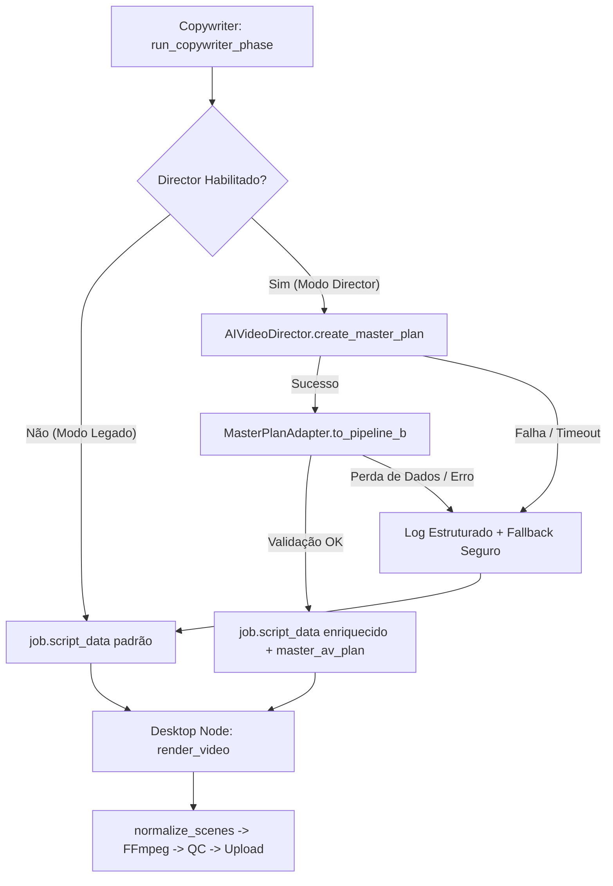

# SPRINT 2.5 — PLANO TÉCNICO DE INTEGRAÇÃO: AI VIDEO DIRECTOR AO PIPELINE B

> **Status:** Planejamento Técnico (Aguardando Aprovação)  
> **Escopo:** Integração incremental do `AIVideoDirector` (Fase 2) ao Pipeline B operacional (`cloud_hub/core/copywriter.py` + `desktop_node.py`).  
> **Restrição:** Este documento é exclusivamente de planejamento. Nenhuma alteração de código, banco de dados ou deploy foi realizada.

---

## 1. Diagnóstico do Fluxo Atual (Pipeline B)

A auditoria do código-fonte revelou o fluxo operacional exato do Pipeline B:

1. **Criação do Job e Roteirização (`cloud_hub/core/copywriter.py`)**:
   - A função `run_copywriter_phase(session: Session, job: VideoJob)` invoca o LLM, realiza parse e validação do JSON gerado (`validate_and_fix_script`) e popula `job.script_data` (sanitizado via `sanitize_script_glossary`).
   - O dicionário `job.script_data` transporta: `title`, `marketing_strategy`, `description`, `tags`, `script_full`, `scenes` (lista de dicts com `timestamp`, `narration`, `b_roll_visual`, etc.), `music_mood`, `language`, `cta_link`, `quiz` e `generated_at`.
2. **Entrega ao Desktop Node (`desktop_node.py`)**:
   - A função `render_video(job_data)` recebe o payload do job contendo `job_id`, `script_data`, `topic`, `language`, `is_short`, entre outros.
3. **Narração e Legendas (`desktop_node.py`)**:
   - `generate_voice_master(script_text, audio_path, ...)` gera o áudio master via Edge-TTS usando `script_obj.get("script_full") or script_obj.get("script")`.
   - `generate_subtitles_locally(audio_path, job_id)` gera o arquivo `.srt` via Whisper.
4. **Normalização das Cenas (`desktop_node.py` + `shared/scene_normalizer.py`)**:
   - Na linha 2075–2076 de `desktop_node.py`, `normalize_scenes(script_obj.get("scenes", []), fallback_topic=topic)` normaliza a lista de cenas para o formato operacional esperado pelo worker.
   - Em seguida, `desktop_node.py` extrai `visual_cues` / `micro_cues` de cada cena.
5. **Seleção de Mídia, Montagem FFmpeg, QC e Upload (`desktop_node.py`)**:
   - `download_assets(scene, scene_index=0)` consome `b_roll_visual`, `b_roll_query`, `sfx_cue` e `narration`/`text` para buscar mídia (Pollinations na cena 0/hook, Pexels/Pixabay nas demais).
   - O FFmpeg (com aceleração QSV) realiza a montagem final.
   - `validator.execute_quality_control()` executa o Quality Control local.
   - `upload_queue` / `upload_worker_loop()` envia o vídeo via `agents/publisher/playwright_uploader.py`.

---

## 2. Arquitetura Atual vs. Arquitetura Proposta

### 2.1 Arquitetura Atual
```
[Copywriter (Cloud Hub)] -> job.script_data (scenes legado)
         │
         ▼
[Desktop Node (render_video)]
   ├── Edge-TTS + Whisper
   ├── normalize_scenes() -> scenes_list (dict operacional)
   ├── download_assets() (Pollinations / Pexels / Pixabay)
   ├── FFmpeg (QSV)
   ├── Quality Control
   └── Playwright Uploader
```

### 2.2 Arquitetura Proposta (Com Modo Dual e Adapter)
O `AIVideoDirector` é introduzido como uma etapa **opcional e isolada** logo após o `Copywriter` (ou antes da entrega ao `Desktop Node`), produzindo um `MasterAVPlan` que é convertido pelo `MasterPlanAdapter` para o contrato operacional do Pipeline B, preservando `script_data["scenes"]` compatível com `normalize_scenes()` e anexando metadados enriquecidos sem quebrar consumidores legados.

---

## 3. Ponto de Integração

**Ponto escolhido:** Pós-Copywriter no Cloud Hub (`cloud_hub/core/copywriter.py` ou orquestrador imediatamente subsequente antes de disponibilizar `job.script_data` para o `desktop_node.py`).

**Justificativa:**
- Evita chamadas LLM pesadas dentro do `desktop_node.py` (worker de renderização local Windows).
- Centraliza observabilidade, controle de timeout e fallback antes do despacho do job.
- Mantém o `desktop_node.py` agnóstico à existência do `AIVideoDirector`, consumindo `script_data` normalmente via `normalize_scenes()`.

---

## 4. Diagrama de Integração



---

## 5. Contratos de Dados e Auditoria do Master AV Plan

### 5.1 Estrutura do `MasterAVPlan` (`agents/video_director/master_plan_models.py`)
- **Campos obrigatórios:** `plan_id`, `schema_version` (`"2.4.0"`), `created_at`, `production_profile`, `central_theme`, `visual_bible` (`VisualBible`), `total_scenes` (`>= 1`), `total_duration_seconds` (`> 0`), `scenes` (`List[PlannedScene]`), `execution_metadata` (`ExecutionMetadata`).
- **Campos opcionais:** `validation_summary` (`Dict[str, Any]`).
- **Métricas (`ExecutionMetadata` / `StageExecutionMetrics`):** `total_duration_seconds`, `production_profile`, `stages` (status, duration, scene_count_in/out, error_type, error_message sanitizada), `components`, `warnings`.
- **Conversão Canônica:** `MasterAVPlan.to_canonical_scenes()` retorna `List[Scene]` (Contrato Scene V2).

### 5.2 Matriz Explícita de Mapeamento Audiovisual (Master AV Plan -> Pipeline B)

Para evitar perda silenciosa de decisões audiovisuais, distingue-se explicitamente três níveis de tratamento para cada campo:
1. **Campo Preservado:** Armazenado em estrutura separada (`director_metadata` / `unconsumed_director_fields`) para rastreabilidade e uso futuro, sem mutação.
2. **Campo Transportado:** Convertido para o dicionário operacional de cena em `script_data["scenes"]` e compatível com `normalize_scenes()`, mas ainda sem consumidor ativo no `desktop_node.py` / FFmpeg atual.
3. **Campo Efetivamente Utilizado na Produção:** Consumido diretamente por `desktop_node.py` (`Edge-TTS`, `Whisper`, `download_assets`, `FFmpeg`, `QC`).

> **Regra de Auditoria:** Um campo **NÃO** é considerado consumido apenas por ter sido armazenado em `master_av_plan_summary`.

| Campo de Origem (`MasterAVPlan` / `PlannedScene`) | Campo de Destino (Contrato Operacional) | Efetivamente Consumido pelo Pipeline B? | Apenas Preservado para Uso Futuro? | Exige Novo Consumidor? | Risco de Perda de Informação | Classificação |
|---|---|---|---|---|---|---|
| `narration` | `scenes[i]["narration"]` (e `text`) | **Sim** (Edge-TTS / `download_assets`) | Não | Não | **Crítico** (validado integralmente pelo Adapter) | Utilizado na produção |
| `scene_id` | `scenes[i]["id"]` e `scenes[i]["scene_id"]` | **Sim** (`normalize_scenes` / indexação) | Não | Não | **Crítico** (validado integralmente pelo Adapter) | Utilizado na produção |
| `order` | Posição na lista + `scenes[i]["order"]` | **Sim** (ordenação sequencial) | Não | Não | **Crítico** (validado integralmente pelo Adapter) | Utilizado na produção |
| `duration_seconds` | `scenes[i]["duration_s"]` e `duration_seconds` | **Sim** (`normalize_scenes` / referência) | Não | Não | **Alto** (validado pelo Adapter) | Utilizado na produção |
| `b_roll_visual` | `scenes[i]["b_roll_visual"]` | **Sim** (`download_assets`) | Não | Não | **Alto** | Utilizado na produção |
| `b_roll_query` | `scenes[i]["b_roll_query"]` | **Sim** (`download_assets` / Pexels / Pixabay) | Não | Não | **Alto** | Utilizado na produção |
| `sfx_cue` | `scenes[i]["sfx_cue"]` | **Sim** (`download_assets` / áudio) | Não | Não | **Médio** | Utilizado na produção |
| `visual_cues` (em `extra_fields` / `continuity_notes`) | `scenes[i]["visual_cues"]` | **Sim** (`desktop_node.py` extrai cues) | Não | Não | **Médio** | Utilizado na produção |
| `micro_cues` (em `extra_fields` / `continuity_notes`) | `scenes[i]["micro_cues"]` | **Sim** (`desktop_node.py` extrai cues) | Não | Não | **Médio** | Utilizado na produção |
| `camera_framing` | `scenes[i]["camera_framing"]` | **Não** (apenas validado por `normalize_scenes`) | Não (transportado na cena) | **Sim** (FFmpeg / Gerador de Imagem) | **Médio** (se descartado na conversão) | Transportado |
| `camera_movement` | `scenes[i]["camera_movement"]` | **Não** (apenas validado por `normalize_scenes`) | Não (transportado na cena) | **Sim** (FFmpeg / Ken Burns / Zoom) | **Médio** (se descartado na conversão) | Transportado |
| `narrative_purpose` | `scenes[i]["narrative_purpose"]` | **Não** (apenas validado por `normalize_scenes`) | Não (transportado na cena) | **Sim** (Roteiro / Retenção / QC) | **Baixo** | Transportado |
| `visual_production_type` | `scenes[i]["visual_production_type"]` | **Não** (apenas validado por `normalize_scenes`) | Não (transportado na cena) | **Sim** (Roteador de Assets: AI vs Stock vs 3D) | **Médio** | Transportado |
| `visual_bible` (`VisualBible` global) | `director_metadata["visual_bible"]` | **Não** | **Sim** | **Sim** (Prompting global / Color grading FFmpeg) | **Alto** (se não preservado em estrutura separada) | Preservado |
| `transition_in` / `transition_out` / `transition_rationale` | `scenes[i]["transition_in"]`, `transition_out` + `director_metadata` | **Não** | Parcial (transportado + preservado) | **Sim** (FFmpeg xfade) | **Baixo** | Transportado / Preservado |
| `depth_of_field`, `composition`, `atmosphere`, `what_viewer_sees`, `dominant_element`, `visual_intent`, `planning_rationale` | `director_metadata["scenes_unconsumed"][scene_id]` | **Não** | **Sim** | **Sim** (Gerador de prompts / Composição) | **Médio** | Preservado |

### 5.3 Contrato do `MasterPlanAdapter`
O adapter deve:
1. Converter `MasterAVPlan.to_canonical_scenes()` para a lista de dicionários operacionais em `script_data["scenes"]`, retornando estruturas independentes (via `copy.deepcopy`) sem modificar o `MasterAVPlan` de origem.
2. Garantir preservação **literal (byte a byte)** de `narration` no Adapter, além de `id`/`scene_id`, `order`, `duration_s` / `duration_seconds`, `b_roll_visual` e `b_roll_query`.
   - **Nota sobre `normalize_scenes()`:** Ao passar as cenas pelo `shared.scene_normalizer.normalize_scenes()`, o normalizador aplica `.strip()` nas extremidades da string `narration` (transformação permitida), preservando integralmente o conteúdo textual interno sem truncamento.
3. Preservar integralmente `planned.visual_direction.model_dump()` e metadados sem consumidor em `director_metadata["scenes_unconsumed"][scene_id]`.
4. Validar que `len(adapted_scenes) == master_plan.total_scenes`, que os `scene_id`s coincidem e que nenhum campo foi descartado silenciosamente.
5. Anexar `script_data["master_av_plan_summary"]` (versão resumida e segura, sem segredos) para rastreabilidade, mantendo `script_data["scenes"]` 100% compatível com `normalize_scenes()`.

---

## 6. Estratégia de Compatibilidade e Feature Flag

- **Modo Padrão:** O modo padrão continua sendo estritamente `"legacy"`.
- **Prioridade de Configuração:** A configuração explícita por job (`job_config.video_director_mode` / `job.script_data` override) tem **prioridade absoluta** sobre a configuração global de ambiente (`VIDEO_DIRECTOR_MODE`).
- **Comportamento na Ausência de Configuração:** Quando nem o job nem o ambiente definirem o modo (ou o valor for inválido/vazio), o sistema assume `"legacy"` de forma determinística.
- **Isolamento Multi-Tenant:** A resolução da flag, a instância de execução do `AIVideoDirector` e os metadados gerados são estritamente escopados por `job_id` e `tenant_id` (sem estado global mutável compartilhado entre tenants ou jobs concorrentes).
- **Proteção contra Execução Duplicada:** Antes de invocar o `AIVideoDirector`, o orquestrador verifica se `script_data` já possui marcador de execução concluída para o mesmo `job_id` / `plan_id` (idempotência), evitando reexecução duplicada do Director em retries.
- **Zero Migração Obrigatória:** Jobs sem a flag ou em modo `"legacy"` seguem o fluxo exato atual.
- **Preservação de Perfis:** `PILOT_5MIN`, `STANDARD_10MIN`, `DOCUMENTARY_20MIN` e `SHORTS` são repassados diretamente ao `AIVideoDirector.create_master_plan(..., production_profile=...)`.

---

## 7. Estratégia de Fallback e Recuperação

Em qualquer falha do `AIVideoDirector` ou do `MasterPlanAdapter`:
- Timeout atingido (`AIVideoDirectorError` / `TimeoutError`).
- Provedor LLM indisponível.
- `MasterAVPlan` inválido ou erro de validação Pydantic.
- Perda de informação detectada pelo Adapter (divergência de contagem de cenas, ordem, duração ou narração).

**Comportamento Obrigatório:**
1. Capturar a exceção estruturada (`AIVideoDirectorError`, `MasterPlanAdapterError` ou erro inesperado).
2. **Registrar todos os fallbacks** de forma estruturada e sanitizada, identificando explicitamente:
   - `fallback_triggered = True`
   - `failed_stage` (ex.: `narrative_analyzer`, `visual_director`, `scene_planner`, `master_plan_adapter`)
   - `fallback_reason` (tipo do erro + mensagem sanitizada, sem segredos/tokens)
3. **Retornar imediatamente** o `script_data` original produzido pelo Copywriter (fluxo legado), garantindo que o vídeo não deixe de ser produzido.

---

## 8. Estratégia de Observabilidade

Registrar por `job_id` (sempre sanitizado, sem chaves, tokens ou payloads sensíveis):
- `director_mode`: `"legacy"` ou `"director"`.
- `fallback_triggered`: `bool` e `fallback_reason` (stage + error_type).
- `plan_id` e `schema_version` (quando gerado).
- `total_scenes` e `total_duration_seconds`.
- `stage_metrics`: duração de `narrative_analyzer`, `visual_director`, `scene_planner` e `adapter`.

---

## 9. Matriz de Testes e Critérios de Aceite

| ID | Cenário de Teste | Critério de Aceite |
|---|---|---|
| T1 | Unitário: `MasterPlanAdapter` válido | Converte `MasterAVPlan` preservando 100% de `narration`, `scene_id`, `order`, `duration_seconds`, `b_roll_visual`, `b_roll_query`. |
| T2 | Unitário: Detecção de perda de dados | Adapter levanta erro explícito se houver divergência de contagem de cenas ou alteração de narração. |
| T3 | Compatibilidade com `normalize_scenes` | Saída do Adapter passa por `shared.scene_normalizer.normalize_scenes()` sem erros ou mutações inesperadas. |
| T4 | Modo Legado vs. Modo Director | Flag `"legacy"` não invoca `AIVideoDirector`; flag `"director"` invoca e enriquece `script_data`. |
| T5 | Fallback em Falha / Timeout do Director | Erro ou timeout no `AIVideoDirector` aciona fallback para `script_data` legado com log sanitizado, sem quebrar o job. |
| T6 | Isolamento Multi-Tenant | Execução concorrente de jobs de tenants distintos não compartilha estado nem vaza dados entre planos. |
| T7 | Perfis de Produção | Testes com `PILOT_5MIN`, `STANDARD_10MIN`, `DOCUMENTARY_20MIN` e `SHORTS` respeitam limites e contratos. |
| T8 | Regressão Pipeline B | Suíte existente (215+ testes) permanece 100% aprovada. |

---

## 10. Riscos e Mitigações

1. **Aumento de latência / timeout no Copywriter:** Mitigado pelo timeout configurável do `AIVideoDirector` e fallback automático para modo legado.
2. **Divergência entre duração planejada e áudio real (Edge-TTS):** O `desktop_node.py` continua usando a duração real do áudio via FFmpeg/Whisper como fonte da verdade na montagem.
3. **Perda silenciosa de metadados visuais:** Mitigado pela validação estrita no `MasterPlanAdapter` antes de entregar ao `desktop_node.py`.
4. **Custo adicional de LLM:** Mitigado pelo controle via feature flag (`legacy` por padrão até homologação).

---

## 11. Divisão da Sprint 2.5 (Tarefas Pequenas e Independentes)

1. **Tarefa 1 — `MasterPlanAdapter` (`agents/video_director/pipeline_adapter.py`)**
   - *Objetivo:* Converter `MasterAVPlan` para o contrato operacional do Pipeline B com validação anti-perda.
   - *Dependências:* Nenhuma.
   - *Testes:* Unitários T1, T2, T3.
2. **Tarefa 2 — Orquestração e Fallback no Cloud Hub (`cloud_hub/core/copywriter.py` ou helper dedicado)**
   - *Objetivo:* Integrar chamada opcional ao `AIVideoDirector` + `MasterPlanAdapter` após `run_copywriter_phase`, com feature flag e fallback seguro.
   - *Dependências:* Tarefa 1.
   - *Testes:* T4, T5, T6.
3. **Tarefa 3 — Observabilidade Sanitizada**
   - *Objetivo:* Registrar métricas de execução, modo (`legacy`/`director`) e motivo de fallback por `job_id` sem expor segredos.
   - *Dependências:* Tarefa 2.
   - *Testes:* Verificação de logs e ausência de tokens/chaves.
4. **Tarefa 4 — Suíte de Testes de Integração e Regressão**
   - *Objetivo:* Implementar testes T1–T8 cobrindo todos os perfis (`PILOT_5MIN`, `STANDARD_10MIN`, `DOCUMENTARY_20MIN`, `SHORTS`).
   - *Dependências:* Tarefas 1, 2 e 3.
   - *Testes:* Execução completa da suíte (215+ testes).

---

## 12. Estratégia de Homologação

1. Aprovação deste plano técnico.
2. Execução sequencial das Tarefas 1 a 4 com revisão de diff por tarefa.
3. Execução da suíte completa de regressão (meta: 100% dos 215+ testes aprovados).
4. Teste piloto controlado com `VIDEO_DIRECTOR_MODE="director"` em 1 job de cada perfil antes de habilitar em produção.
