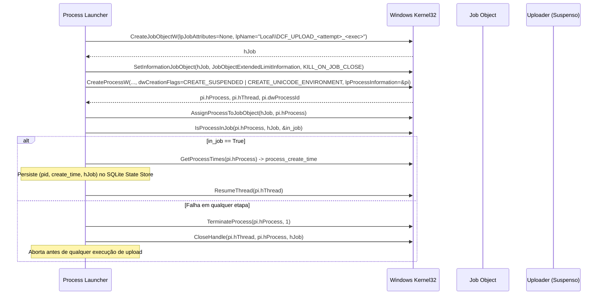

# DARK CHANNEL FACTORY — SPRINT 2.7
## ETAPA 1 — PLANO DE IMPLEMENTAÇÃO TÉCNICA DO LOCAL WATCHDOG

**Status:** Plano Técnico de Implementação (Exclusivamente Documental)  
**Pré-requisitos Homologados (Etapa 0.8):**
- [SPRINT_2_7_LOCAL_WATCHDOG_DESIGN.md](file:///c:/Users/User/.gemini/antigravity/scratch/dark-channel-factory/docs/diagnostics/SPRINT_2_7_LOCAL_WATCHDOG_DESIGN.md)
- [SPRINT_2_7_PLAYWRIGHT_TERMINATION_PROTOCOL.md](file:///c:/Users/User/.gemini/antigravity/scratch/dark-channel-factory/docs/diagnostics/SPRINT_2_7_PLAYWRIGHT_TERMINATION_PROTOCOL.md)
- [SPRINT_2_7_UPLOAD_TERMINATION_EVIDENCE.md](file:///c:/Users/User/.gemini/antigravity/scratch/dark-channel-factory/docs/diagnostics/SPRINT_2_7_UPLOAD_TERMINATION_EVIDENCE.md)
- [SPRINT_2_7_WATCHDOG_FAILURE_MATRIX.md](file:///c:/Users/User/.gemini/antigravity/scratch/dark-channel-factory/docs/diagnostics/SPRINT_2_7_WATCHDOG_FAILURE_MATRIX.md)
- [SPRINT_2_7_WATCHDOG_IMPLEMENTATION_READINESS.md](file:///c:/Users/User/.gemini/antigravity/scratch/dark-channel-factory/docs/diagnostics/SPRINT_2_7_WATCHDOG_IMPLEMENTATION_READINESS.md)

> [!IMPORTANT]
> **RESTRIÇÃO DE ESCOPO (ETAPA 1):** Este documento é exclusivamente um plano técnico. Nenhum código de produção, migration, banco de dados, Cloud Hub, Desktop Node, Pipeline B ou homologação da Sprint 2.6 foi modificado.

---

## 1. OBJETIVO E REGRA DE PRESERVAÇÃO

### 1.1. Objetivo
Transformar a especificação consolidada da Etapa 0.8 em um plano executável em tarefas pequenas, independentes, auditáveis e com critérios objetivos de aceitação para o **Local Watchdog** no Windows, garantindo isolamento de processos de upload via Windows Job Objects, persistência durável (SQLite WAL + Outbox), entrega idempotente de evidências ao Cloud Hub e reconciliação independente no YouTube.

### 1.2. Regra de Preservação (Sprint 2.6 e Pipeline B)
- **Pipeline B** permanece integralmente preservado como arquitetura operacional.
- **Módulos protegidos (NÃO reabrir):**
  - `DirectorExecutionInterpreter`
  - `DirectorMediaRouter`
  - `DirectorCameraEngine`
  - `Universal Scene Contract V2`
  - `Master AV Plan`
  - Todas as homologações e suítes de teste da **Sprint 2.6**.
- O escopo de alteração no Desktop Node limita-se ao fluxo de **upload** (`upload_worker_loop()` em `desktop_node.py` e novos módulos em `desktop_worker/`), sem tocar em `render_video()` ou na geração de mídia.

---

## 2. ARQUITETURA DE MÓDULOS

### 2.1. Estrutura de Arquivos Proposta

```text
desktop_worker/
  watchdog/
    __init__.py
    job_object.py          # C. Windows Job Object Manager
    process_launcher.py    # A. Upload Process Launcher (CreateProcessW + Job)
    identity.py            # F. Process Identity Validator
    state_store.py         # D. Upload State Store (SQLite WAL)
    outbox.py              # E. Durable Outbox + Hub Client
    watchdog_daemon.py     # B. Local Watchdog (subprocesso independente)
    youtube_reconcile.py   # G. YouTube Reconciliation (cliente/hook)
cloud_hub/
  routers/
    watchdog_evidence.py   # H. Cloud Hub Evidence Receiver
  models.py                # Extensão aditiva (UploadAttempt, TerminationEvidence)
tests/
  unit/
    test_watchdog_identity.py
    test_watchdog_state_store.py
    test_watchdog_outbox.py
    test_watchdog_state_machine.py
  integration/
    test_win_job_object.py
    test_win_process_launcher.py
```

### 2.2. Responsabilidades por Módulo

| Módulo | Responsabilidade Principal | Interface / Contrato |
|---|---|---|
| **A. Upload Process Launcher** (`process_launcher.py`) | Criar Job Object, criar processo uploader com `CREATE_SUSPENDED`, associar ao Job Object, validar `IsProcessInJob`, executar `ResumeThread` somente após confirmação, abortar com segurança em caso de falha. | `launch_isolated_upload(cmd, env, cwd, attempt_ctx) -> LaunchResult` |
| **B. Local Watchdog** (`watchdog_daemon.py`) | Monitorar heartbeat e timeout, detectar execuções órfãs, recuperar estado pós-reboot, solicitar encerramento da árvore via Job Object, validar identidade e gerar evidência. | Subprocesso CLI: `python -m desktop_worker.watchdog.watchdog_daemon --worker-id <id>` |
| **C. Windows Job Object Manager** (`job_object.py`) | Criar/abrir Job Objects (`CreateJobObjectW` / `OpenJobObjectW`), configurar `JOB_OBJECT_LIMIT_KILL_ON_JOB_CLOSE`, consultar `JobObjectBasicAccountingInformation` e `JobObjectBasicProcessIdList` (detectando truncamento), executar `TerminateJobObject`. | `JobObjectManager.create(name)`, `.open(name)`, `.get_accounting()`, `.get_pid_list()`, `.terminate(exit_code)` |
| **D. Upload State Store** (`state_store.py`) | Persistência local SQLite (`WAL`, `PRAGMA synchronous = FULL`), registro de execuções, tentativas, identidades, evidências, checkpoints e checksum SHA-256. | `StateStore.record_execution(...)`, `.update_heartbeat(...)`, `.save_evidence(...)` |
| **E. Durable Outbox** (`outbox.py`) | Persistir eventos antes do envio, calcular checksum, enviar ao Cloud Hub com retry exponencial + jitter, processar ACK, reter/arquivar eventos, recuperar após falha. | `OutboxPublisher.enqueue(event)`, `.flush_pending()` |
| **F. Process Identity Validator** (`identity.py`) | Validar tupla `(pid, process_create_time, attempt_id, execution_id, fencing_token, job_object_name, worker_id)`. Proibir terminantemente kill genérico por PID. | `IdentityValidator.verify(expected: ProcessIdentity) -> IdentityStatus` |
| **G. YouTube Reconciliation** (`youtube_reconcile.py`) | Reconciliar estado externo no YouTube Studio (`FOUND_PUBLISHED`, `CONFIRMED_ABSENT`, `CHECK_FAILED`, `MULTIPLE_CANDIDATES`) de forma 100% independente da evidência de término local. | `reconcile_upload(job_id, channel_id, title_hash) -> ReconciliationResult` |
| **H. Cloud Hub Evidence Receiver** (`watchdog_evidence.py`) | Receber evidências via HTTP, validar identidade, `fencing_token` e `attempt_id`, garantir idempotência por `event_id`, atualizar máquina de estados atomicamente, rejeitar eventos stale (`409`). | `POST /worker/upload-termination-evidence` |

---

## 3. DECISÃO OBRIGATÓRIA: PROCESS LAUNCHER WINDOWS

### 3.1. Avaliação de Alternativas

| Critério | `ctypes` + `CreateProcessW` (Win32 API direta) | `pywin32` (`win32process`, `win32job`) | `subprocess.Popen` (stdlib) |
|---|---|---|---|
| **Acesso ao `hThread` principal** | **Direto** via `PROCESS_INFORMATION.hThread` | **Direto** via tupla `(hProcess, hThread, dwPid, dwTid)` | **Não expõe `hThread`** (impossibilita `ResumeThread` seguro sem hacks internos) |
| **`CREATE_SUSPENDED`** | Suporte nativo (`dwCreationFlags = 0x00000004`) | Suporte nativo | Suporte parcial via `creationflags`, mas sem `hThread` para retomar |
| **Dependências externas** | **Zero** (stdlib `ctypes` + `kernel32.dll`) | Requer pacote C++ `pywin32` (risco de build/ABI) | Zero |
| **Controle de Handles** | Total (`CloseHandle` explícito em `finally`) | Gerenciado por `PyHANDLE` | Opaco |

**Decisão Recomendada:** **`ctypes` + `CreateProcessW`** (`kernel32.dll`). Elimina dependência externa de `pywin32`, resolve a ambiguidade de `subprocess.Popen` e dá controle exato sobre `hProcess` e `hThread`.

### 3.2. Fluxo Técnico Detalhado (10 Pontos Obrigatórios)



1. **Obtenção do `HANDLE` do processo:** `CreateProcessW` preenche a struct `PROCESS_INFORMATION`, retornando `pi.hProcess` (`HANDLE`).
2. **Obtenção do `HANDLE` da thread principal:** `CreateProcessW` preenche `pi.hThread` (`HANDLE`) na mesma struct `PROCESS_INFORMATION`.
3. **Criação do processo suspenso:** Passar `dwCreationFlags = CREATE_SUSPENDED (0x00000004) | CREATE_UNICODE_ENVIRONMENT (0x00000400) | CREATE_NO_WINDOW (0x08000000)` para `CreateProcessW`. Nenhuma instrução de usuário (incluindo Python/Playwright) é executada enquanto suspenso.
4. **Associação ao Job Object:** Chamar `AssignProcessToJobObject(hJob, pi.hProcess)` imediatamente após `CreateProcessW`.
5. **Confirmação `IsProcessInJob`:** Chamar `IsProcessInJob(pi.hProcess, hJob, ctypes.byref(in_job))`. Exigir retorno não-zero da API e `in_job.value == True`.
6. **Execução de `ResumeThread`:** Somente após `IsProcessInJob == True`, coletar `GetProcessTimes(pi.hProcess)` (`process_create_time`), persistir no SQLite State Store e então chamar `ResumeThread(pi.hThread)`.
7. **Aborto em caso de falha:** Se `AssignProcessToJobObject`, `IsProcessInJob` ou a persistência no SQLite falhar, chamar `TerminateProcess(pi.hProcess, 1)` enquanto o processo ainda está suspenso, registrar erro e lançar exceção.
8. **Garantia de não-execução prévia:** Como a thread principal nasce suspensa (`CREATE_SUSPENDED`) e só recebe `ResumeThread` após `IsProcessInJob == True` e commit no SQLite, é fisicamente impossível o uploader iniciar o Playwright antes da associação.
9. **Tratamento e fechamento seguro de handles:** Utilizar bloco `try ... finally` fechando `pi.hThread` e `pi.hProcess` via `CloseHandle`. O `hJob` pode ser fechado pelo launcher após o Watchdog/State Store assumir, ou mantido aberto enquanto o launcher monitorar, lembrando que `JOB_OBJECT_LIMIT_KILL_ON_JOB_CLOSE` mata o Job se o último handle fechar.
10. **Processos já pertencentes a outro Job Object:** No Windows 8/10/11/Server 2012+, Job Objects suportam aninhamento (*nested jobs*). Contudo, se o processo pai (`desktop_node.py`) estiver em um Job restrito que proíba aninhamento ou `AssignProcessToJobObject` retornar `ERROR_ACCESS_DENIED (5)`:
    - Tentar `CREATE_BREAKAWAY_FROM_JOB (0x01000000)` apenas se permitido pelo Job pai;
    - Caso `AssignProcessToJobObject` falhe definitivamente, **abortar o lançamento** (`TerminateProcess` na thread suspensa) e reportar falha de isolamento (`INCONCLUSIVE` / `FAILED_PRE_UPLOAD`), nunca prosseguir sem Job Object.

---

## 4. WATCHDOG: PROCESSO OU THREAD?

| Critério | Opção A: Thread em `desktop_node.py` | Opção B: Subprocesso Independente | Opção C: Windows Service |
|---|---|---|---|
| **Independência do `desktop_node.py`** | Baixa (morre se `desktop_node` travar/crashar) | **Alta** (processo separado, sobrevive a crash do `desktop_node`) | Máxima (gerenciado pelo SCM) |
| **Crash Recovery** | Ruim (não detecta travamento do próprio processo) | **Bom** (detecta morte do `desktop_node` e limpa órfãos) | Excelente |
| **Complexidade** | Baixa | **Moderada** (Mutex Windows + SQLite WAL) | Alta (requer privilégios Admin, SCM, empacotamento) |
| **Permissões** | Mesmas do usuário | **Mesmas do usuário** (sem necessidade de Admin) | Requer SYSTEM / Admin |
| **Deploy** | Simples | **Simples** (iniciado pelo `desktop_node` ou `RUN_FACTORY.bat`) | Complexo (instalação de serviço) |
| **Observabilidade** | Logs misturados | **Logs dedicados** (`watchdog.log`) | Event Viewer + logs |
| **Risco Operacional** | Alto (ponto único de falha) | **Baixo / Proporcional** | Médio (permissões/sessão GUI) |

**Decisão Recomendada:** **Opção B — Watchdog Subprocesso Independente** para a primeira implementação da Sprint 2.7.
- Garante independência de falhas em relação ao `desktop_node.py` sem exigir privilégios de Administrador ou complexidade de Windows Service.
- Exclusão mútua garantida por Mutex nomeado do Windows: `Local\DCF_WATCHDOG_LOCK_<worker_id>`. Se o watchdog morrer, o Windows libera o mutex com `WAIT_ABANDONED`, permitindo que uma nova instância assuma imediatamente.

---

## 5. STATE STORE SQLITE

Localização: `app_data/watchdog_state_<worker_id>.db`  
Pragmas obrigatórios na conexão:
```sql
PRAGMA journal_mode = WAL;
PRAGMA synchronous = FULL;
PRAGMA foreign_keys = ON;
PRAGMA busy_timeout = 5000;
```

### 5.1. Schema Completo

```sql
CREATE TABLE IF NOT EXISTS upload_execution (
    execution_id TEXT PRIMARY KEY,              -- UUIDv4 local
    attempt_id TEXT NOT NULL,                   -- UUID do Cloud Hub
    job_id TEXT NOT NULL,
    tenant_id TEXT NOT NULL,
    channel_id TEXT NOT NULL,
    worker_id TEXT NOT NULL,
    fencing_token INTEGER NOT NULL,
    browser_user_data_dir TEXT NOT NULL,
    boot_time_utc TEXT NOT NULL,                -- ISO-8601 UTC (LastBootUpTime)
    status TEXT NOT NULL,                       -- RUNNING, TERMINATING, CLOSED, INCONCLUSIVE
    created_at_utc TEXT NOT NULL,
    updated_at_utc TEXT NOT NULL
);

CREATE TABLE IF NOT EXISTS upload_attempt (
    attempt_id TEXT PRIMARY KEY,
    job_id TEXT NOT NULL,
    fencing_token INTEGER NOT NULL,
    hub_status TEXT NOT NULL,                   -- INTENT, IN_PROGRESS, UNKNOWN, TERMINATED, CONFIRMED
    last_heartbeat_at_utc TEXT,
    created_at_utc TEXT NOT NULL,
    updated_at_utc TEXT NOT NULL
);

CREATE TABLE IF NOT EXISTS process_identity (
    id INTEGER PRIMARY KEY AUTOINCREMENT,
    execution_id TEXT NOT NULL REFERENCES upload_execution(execution_id),
    attempt_id TEXT NOT NULL,
    pid INTEGER NOT NULL,
    process_create_time REAL NOT NULL,          -- FILETIME / epoch float do GetProcessTimes
    job_object_name TEXT NOT NULL,
    role TEXT NOT NULL,                         -- UPLOADER_MAIN, PLAYWRIGHT_NODE, BROWSER
    recorded_at_utc TEXT NOT NULL,
    UNIQUE(execution_id, pid, process_create_time)
);

CREATE TABLE IF NOT EXISTS termination_evidence (
    event_id TEXT PRIMARY KEY,                  -- UUIDv4 (chave de idempotência)
    attempt_id TEXT NOT NULL,
    execution_id TEXT NOT NULL REFERENCES upload_execution(execution_id),
    job_id TEXT NOT NULL,
    worker_id TEXT NOT NULL,
    fencing_token INTEGER NOT NULL,
    pid INTEGER NOT NULL,
    process_create_time REAL NOT NULL,
    job_object_name TEXT NOT NULL,
    verification_result TEXT NOT NULL,          -- TREE_TERMINATED, EXECUTION_ISOLATED, INCONCLUSIVE, etc.
    termination_reason TEXT NOT NULL,
    evidence_source TEXT NOT NULL,
    watchdog_version TEXT NOT NULL,
    termination_requested_at_utc TEXT NOT NULL,
    verified_at_utc TEXT NOT NULL,
    payload_json TEXT NOT NULL,
    checksum_sha256 TEXT NOT NULL
);

CREATE TABLE IF NOT EXISTS outbox_event (
    event_id TEXT PRIMARY KEY,                  -- FK lógica para termination_evidence.event_id
    endpoint TEXT NOT NULL,
    payload_json TEXT NOT NULL,
    checksum_sha256 TEXT NOT NULL,
    status TEXT NOT NULL,                       -- PENDING, ACKED, QUARANTINED, REJECTED_STALE
    retry_count INTEGER NOT NULL DEFAULT 0,
    next_retry_at_utc TEXT NOT NULL,
    last_http_status INTEGER,
    last_error TEXT,
    created_at_utc TEXT NOT NULL,
    acked_at_utc TEXT
);

CREATE TABLE IF NOT EXISTS watchdog_checkpoint (
    worker_id TEXT PRIMARY KEY,
    last_boot_time_utc TEXT NOT NULL,
    last_scan_at_utc TEXT NOT NULL,
    watchdog_pid INTEGER NOT NULL,
    watchdog_version TEXT NOT NULL
);

CREATE INDEX IF NOT EXISTS idx_exec_status ON upload_execution(status);
CREATE INDEX IF NOT EXISTS idx_exec_attempt ON upload_execution(attempt_id);
CREATE INDEX IF NOT EXISTS idx_outbox_pending ON outbox_event(status, next_retry_at_utc);
```

### 5.2. Redundância Intencional para Auditoria
Campos como `attempt_id`, `job_id`, `worker_id`, `fencing_token`, `pid` e `process_create_time` aparecem tanto em `upload_execution`/`process_identity` quanto em `termination_evidence` e `outbox_event.payload_json`. Essa redundância é **intencional**: `termination_evidence` e `outbox_event` funcionam como **snapshots imutáveis** do momento da verificação, garantindo que alterações posteriores de estado ou limpezas de tabelas operacionais não adulterem a prova enviada ao Cloud Hub.

---

## 6. OUTBOX DURÁVEL

### 6.1. Ciclo de Vida Completo (9 Etapas)
1. **Evento criado:** Watchdog gera `event_id` (UUIDv4) e monta payload JSON canônico.
2. **Checksum calculado:** SHA-256 do `payload_json` UTF-8 ordenado (`sort_keys=True`).
3. **Evento persistido:** `INSERT` em `termination_evidence` e `outbox_event` (`status='PENDING'`) na **mesma transação SQLite** (`synchronous=FULL`).
4. **Evento enviado:** `OutboxPublisher` lê eventos `PENDING` com `next_retry_at_utc <= now()`, valida `checksum_sha256` antes de enviar e faz `POST` ao Cloud Hub.
5. **Cloud Hub valida:** Verifica `attempt_id`, `fencing_token`, `worker_id` e `verification_result`.
6. **Cloud Hub processa idempotentemente:** Insere `event_id` (UNIQUE) e executa `UPDATE` atômico se aplicável.
7. **ACK retorna:** HTTP `200 OK` ou `201 Created` com `{ "ack": true, "event_id": "..." }`.
8. **ACK persistido:** Outbox atualiza `status='ACKED'`, `acked_at_utc=now()`.
9. **Retenção/Arquivamento:** Eventos `ACKED` são mantidos por 7 dias para auditoria local e depois arquivados/expurgados por rotina de limpeza.

### 6.2. Matriz de Comportamento em Falhas

| Cenário de Falha | Comportamento do Outbox | Descarte Silencioso? |
|---|---|---|
| **Cloud Hub offline / Timeout** | Mantém `PENDING`, incrementa `retry_count`, aplica backoff exponencial com jitter (ex: 5s, 15s, 45s, máx 300s). | **Não** |
| **HTTP 500 / 502 / 503** | Trata como falha transitória, mantém `PENDING` e agenda retry. | **Não** |
| **HTTP 409 Conflict (Stale / Fencing)** | Marca `REJECTED_STALE` com `last_http_status=409` e `last_error` para auditoria; interrompe retries. | **Não** |
| **Evento duplicado (reenvio)** | Cloud Hub retorna `200 OK` idempotente; Outbox marca `ACKED`. | **Não** |
| **ACK perdido na rede** | Outbox mantém `PENDING` e reenvia; Cloud Hub responde `200 OK` idempotente. | **Não** |
| **SQLite corrompido** | Falha de `PRAGMA integrity_check` no startup bloqueia novos uploads, move DB para backup forense e sinaliza `INCONCLUSIVE`. | **Não** |
| **Checksum inválido ao ler** | Move registro para `QUARANTINED`, nunca envia ao Hub, trata tentativa como `INCONCLUSIVE`. | **Não** |

---

## 7. API CLOUD HUB

### 7.1. Endpoint Proposto
`POST /worker/upload-termination-evidence`

### 7.2. Payload JSON (Request)
```json
{
  "event_id": "550e8400-e29b-41d4-a716-446655440000",
  "attempt_id": "7f9c2a10-1111-4444-8888-000000000001",
  "execution_id": "9b1deb4d-3b7d-4bad-9bdd-2b0d7b3dcb6d",
  "job_id": "123e4567-e89b-12d3-a456-426614174000",
  "tenant_id": "tenant_01",
  "channel_id": "channel_us_01",
  "worker_id": "worker_win_01",
  "fencing_token": 42,
  "pid": 18432,
  "process_create_time": 1731884400.125,
  "job_object_name": "Local\\DCF_UPLOAD_7f9c2a10_9b1deb4d",
  "termination_result": "TREE_TERMINATED",
  "evidence_source": "WINDOWS_JOB_OBJECT",
  "watchdog_version": "2.7.0",
  "termination_requested_at": "2026-11-17T23:00:00Z",
  "verified_at": "2026-11-17T23:00:03Z"
}
```

### 7.3. Respostas e Validações
- **`200 OK` / `201 Created`**: `{ "ack": true, "event_id": "...", "idempotent_replay": false|true, "attempt_status": "TERMINATED|UNKNOWN" }`
- **`409 Conflict`**: `fencing_token` divergente/obsoleto ou tentativa já substituída por tentativa mais recente para o mesmo `job_id`.
- **`422 Unprocessable Entity`**: Payload inválido ou `attempt_id` não pertence ao `job_id`/`worker_id`.

---

## 8. STATE MACHINE

### 8.1. Estados
- **`UploadAttempt`**: `INTENT`, `IN_PROGRESS`, `FAILED_PRE_UPLOAD`, `UNKNOWN`, `CONFIRMED`, `STALE_PUBLISHED_EVIDENCE`, `TERMINATED`
- **`Termination Evidence`**: `REQUESTED`, `OS_SIGNAL_SENT`, `MAIN_PROCESS_EXITED`, `TREE_TERMINATED`, `EXECUTION_ISOLATED`, `INCONCLUSIVE`
- **`Reconciliation`**: `FOUND_PUBLISHED`, `CONFIRMED_ABSENT`, `CHECK_FAILED`, `MULTIPLE_CANDIDATES`

### 8.2. Regras de Transição e Bloqueio de Retry
- **Transições válidas para `TERMINATED`:** Apenas `UNKNOWN -> TERMINATED`.
- **Transições inválidas:** Qualquer transição direta de `INCONCLUSIVE`, `REQUESTED`, `OS_SIGNAL_SENT` ou `MAIN_PROCESS_EXITED` para `TERMINATED`.
- **Regra Obrigatória:** `TREE_TERMINATED` ou `EXECUTION_ISOLATED`, isoladamente, **NÃO** autoriza retry.
- **Condições cumulativas para liberar Retry:**
  1. Evidência válida (`TREE_TERMINATED` ou `EXECUTION_ISOLATED`).
  2. Evidência vinculada ao `attempt_id` correto.
  3. `fencing_token` válido (sem tentativa mais recente).
  4. YouTube Reconciliation == `CONFIRMED_ABSENT`.
  5. Nenhuma execução anterior ativa.
  6. Estado no Cloud Hub atualizado atomicamente (`UPDATE ... WHERE attempt_id = :id AND fencing_token = :token AND status = 'UNKNOWN'`).
- **`INCONCLUSIVE`:** Bloqueia retry automático permanentemente até intervenção humana.

---

## 9. MIGRATION PLAN

- **Alterações Aditivas (SQLite e PostgreSQL/Neon):**
  - Criar tabela `termination_evidences` (`event_id` UNIQUE, `attempt_id`, `execution_id`, `fencing_token`, `termination_result`, `verified_at`, `payload_json`).
  - Adicionar colunas nullable/default em `upload_attempts`: `fencing_token` (INTEGER), `termination_evidence_id` (TEXT/UUID), `reconciliation_status` (TEXT).
  - Criar índice único `(job_id, fencing_token)` ou índice em `(attempt_id, fencing_token)`.
- **Compatibilidade Histórica:** Registros antigos sem `fencing_token` ou evidência **não** recebem backfill artificial; permanecem protegidos (sem retry automático se entrarem em `UNKNOWN`).
- **Ordem de Deploy:** 1) Migration no Cloud Hub; 2) Deploy da API do Cloud Hub; 3) Deploy do Desktop Node com Watchdog.
- **Rollback:** Como as alterações são aditivas, o rollback da aplicação não exige `DROP TABLE`/`DROP COLUMN`, preservando todas as evidências coletadas.

---

## 10. PLANO DE TESTES

| ID | Categoria | Cenário | Setup | Ação | Resultado Esperado | Evidência | Critério PASS/FAIL |
|---|---|---|---|---|---|---|---|
| **UT-01** | Unit | Reuso de PID / `create_time` mismatch | `ProcessIdentity` salvo com `pid=100, t=10.0` | Simular processo atual `pid=100, t=99.0` | Validator retorna `PID_REUSED`, sem kill | Log + retorno enum | PASS se não houver kill |
| **UT-02** | Unit | Fencing token obsoleto | `UploadAttempt` com `token=5` | Enviar evento com `token=4` | Hub retorna `409 Conflict` | HTTP 409 + DB inalterado | PASS se estado não mudar |
| **UT-03** | Unit | Idempotência `event_id` | Evento `E1` já processado | Reenviar `E1` | Hub retorna `200 OK` (`idempotent_replay=true`) | 1 registro no DB | PASS se sem duplicação |
| **UT-04** | Unit | Checksum & State Machine | Payload alterado no Outbox | Ler Outbox para envio | Evento vai para `QUARANTINED`, tentativa `INCONCLUSIVE` | Registro quarentenado | PASS se não enviar ao Hub |
| **WI-01** | Win Integration | `CreateProcessW` + Job Object | `CREATE_SUSPENDED` | `AssignProcessToJobObject` -> `IsProcessInJob` -> `ResumeThread` | Processo inicia dentro do Job | `in_job == True` | PASS se `IsProcessInJob` True antes de `ResumeThread` |
| **WI-02** | Win Integration | `TerminateJobObject` + `ActiveProcesses` | Processo pai + filho no Job | `TerminateJobObject` + `JobObjectBasicAccountingInformation` | `ActiveProcesses == 0` e `PID list` vazia (sem truncamento) | Struct accounting + PID list | PASS se 0 processos ativos |
| **FI-01** | Fault Injection | Crash do `desktop_node.py` | Upload rodando no Job | Matar `desktop_node.py` | Watchdog subprocesso continua vivo e monitorando | `watchdog.log` | PASS se upload monitorado |
| **FI-02** | Fault Injection | Hub Offline + Outbox | Hub inacessível | Gerar `TREE_TERMINATED` | Evento salvo em `PENDING`; enviado após Hub voltar | `outbox_event` `ACKED` | PASS se 0 perda de evidência |
| **FI-03** | Fault Injection | Reboot do Host | Tentativa `RUNNING` com `boot_time=T1` | Simular `boot_time=T2 > T1` no startup | Watchdog gera `EXECUTION_ISOLATED` | Evidência `EXECUTION_ISOLATED` | PASS se validado por boot time |
| **FI-04** | Fault Injection | Múltiplos candidatos YouTube | Upload `UNKNOWN` | Reconciliação retorna `MULTIPLE_CANDIDATES` | Retry bloqueado mesmo com `TREE_TERMINATED` | Estado `UNKNOWN` | PASS se sem novo retry |

---

## 11. IMPLEMENTATION BREAKDOWN

| Task | Objetivo | Arquivos | Dependências | Risco | Testes | Critério de Conclusão | Rollback |
|---|---|---|---|---|---|---|---|
| **TASK 1** | Windows Job Object Manager | `desktop_worker/watchdog/job_object.py` | Nenhuma | Médio | `WI-01`, `WI-02` | Criar, consultar accounting/PID list e encerrar Job | Remover arquivo |
| **TASK 2** | Process Launcher Seguro | `desktop_worker/watchdog/process_launcher.py`, `identity.py` | TASK 1 | Médio | `WI-01`, `UT-01` | `CREATE_SUSPENDED` + `IsProcessInJob` + `ResumeThread` | Reverter chamada |
| **TASK 3** | SQLite State Store | `desktop_worker/watchdog/state_store.py` | Nenhuma | Baixo | `UT-04` | Schema WAL + `synchronous=FULL` + checksum | Remover DB local |
| **TASK 4** | Durable Outbox | `desktop_worker/watchdog/outbox.py` | TASK 3 | Baixo | `UT-03`, `FI-02` | Persistência pré-envio, retry, ACK e quarentena | Desabilitar flush |
| **TASK 5** | Local Watchdog Daemon | `desktop_worker/watchdog/watchdog_daemon.py` | TASK 1, 2, 3, 4 | Médio | `FI-01` | Mutex Windows, heartbeat, timeout e evidência | Matar subprocesso |
| **TASK 6** | Cloud Hub Evidence API | `cloud_hub/routers/watchdog_evidence.py`, `models.py` | Migration | Médio | `UT-02`, `UT-03` | Endpoint idempotente + validação `fencing_token` | Desabilitar rota |
| **TASK 7** | State Machine Integration | `cloud_hub/` (serviço de retry/reconciliação) | TASK 6 | Alto | `FI-04` | Retry só com `CONFIRMED_ABSENT` + `TREE_TERMINATED`/`EXECUTION_ISOLATED` | Feature flag OFF |
| **TASK 8** | Recovery após Reboot | `watchdog_daemon.py`, `state_store.py` | TASK 3, 5 | Médio | `FI-03` | Comparação `LastBootUpTime` UTC | Modo observacional |
| **TASK 9** | Integration & Fault Tests | `tests/unit/`, `tests/integration/` | TASK 1-8 | Baixo | Todos | Suíte verde em Windows | N/A |
| **TASK 10** | Staging Homologation | Ambiente Staging | TASK 9 | Baixo | E2E Staging | Modo observacional -> ativo validado | Feature flag OFF |

---

## 12. ROLLOUT E ROLLBACK

1. **Feature Flag:** `WATCHDOG_MODE = "DISABLED" | "OBSERVATIONAL" | "ACTIVE"`.
2. **Ordem de Deploy:** Cloud Hub (Migration + API) -> Desktop Node (iniciando em `OBSERVATIONAL`).
3. **Modo Observacional:** Watchdog monitora, registra identidades, gera evidências e envia ao Outbox, mas **não** executa `TerminateJobObject` automático.
4. **Canary:** Ativar `ACTIVE` em 1 Desktop Node de staging por 48h.
5. **Critérios de Ativação:** 0 falsos positivos de PID reuse, 100% dos eventos `ACKED` no Outbox, 0 regressões na Sprint 2.6.
6. **Critérios de Rollback:** Qualquer encerramento indevido de processo, corrupção recorrente de SQLite ou falha de `AssignProcessToJobObject` > 1%.
7. **Rollback Seguro:** Alterar `WATCHDOG_MODE = "OBSERVATIONAL"` ou `"DISABLED"` sem apagar o banco `watchdog_state_*.db` nem a tabela `termination_evidences`, preservando todas as evidências para auditoria.
