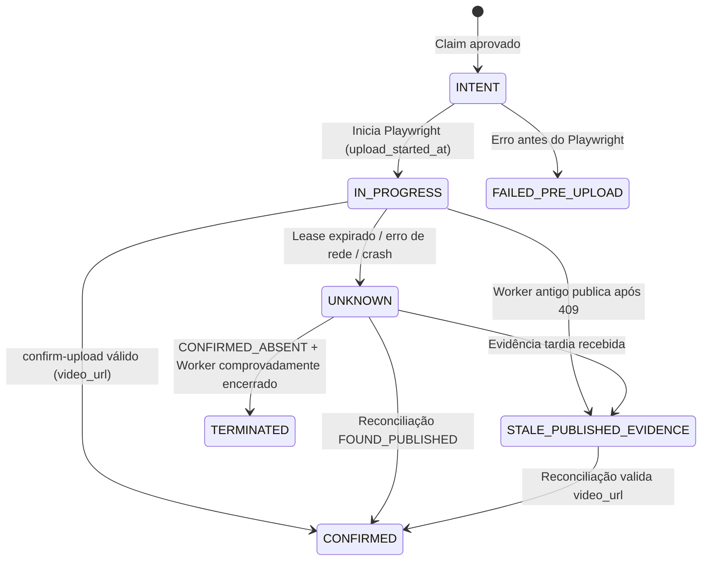

# SPRINT 2.7 — UPLOAD: IDEMPOTÊNCIA E RECUPERAÇÃO DE FALHAS (ETAPA 0.6)

**Status:** Especificação Técnica Final (Somente Leitura / Documental — Corrigida na Etapa 0.6)  
**Escopo:** Tema 2 — `desktop_node.py` (`upload_worker_loop`, `render_video`), `agents/publisher/playwright_uploader.py`, Endpoints do Cloud Hub.

---

## 1. EVIDÊNCIAS COMPROVADAS NO CÓDIGO

- **[COMPROVADO]** Em `desktop_node.py` (linhas 74–148), `upload_worker_loop()` consome `upload_queue` em memória (`Queue()`), chama `publish_video_to_youtube(...)` via Playwright e, em caso de sucesso, apenas imprime `✅ [UPLOAD CONCLUÍDO] {job_id} -> {video_url}` (linha 131).
- **[COMPROVADO]** Em caso de exceção no upload (`desktop_node.py` linhas 132–145), o worker envia `POST {CLOUD_HUB_URL}/worker/job-status` com `status = "FAILED"` (ou `"PENDING_UPLOAD"` se erro de cota), dentro de um `try ... except: pass` silencioso.
- **[COMPROVADO]** Não há registro prévio de intenção de upload no Cloud Hub antes de iniciar o Playwright, nem checkpoint local durável antes/depois da publicação, nem mecanismo de reconciliação para `UPLOAD_UNKNOWN`.

---

## 2. MATRIZ DE CENÁRIOS DE FALHA (A–G)

| Cenário | Estado Antes | Estado Depois | Evidência Disponível | Risco de Duplicidade | Ação de Recuperação | Condição para Nova Tentativa |
|---|---|---|---|---|---|---|
| **A: Falha antes de iniciar o upload** (ex: arquivo ausente, erro de montagem) | `PENDING_UPLOAD` | `FAILED_UPLOAD` (ou `PENDING_UPLOAD` se transitório) | `attempt_id` sem `upload_started_at` ou erro pré-Playwright | **Nulo** | Registrar erro na tentativa e liberar para retry ou correção | `attempt_status == FAILED_PRE_UPLOAD` |
| **B: Falha durante o upload, sem confirmação do YouTube** (ex: queda de rede no meio do stream) | `UPLOADING` | `UPLOAD_UNKNOWN` | `upload_started_at` preenchido, sem `video_url` | **Médio/Alto** (YouTube pode ter recebido 100% antes da queda) | Mover para `UPLOAD_UNKNOWN`; exigir reconciliação + comprovação de encerramento | `CONFIRMED_ABSENT` **+** tentativa anterior comprovadamente encerrada/isolada |
| **C: YouTube conclui publicação, Desktop Node perde conexão antes de receber URL** | `UPLOADING` | `UPLOAD_UNKNOWN` | Timeout ou erro de rede após envio dos bytes | **Crítico** (vídeo já existe no YouTube) | Reconciliar no YouTube Studio por canal + título + janela temporal | **Proibido retry** se vídeo encontrado; marcar `PUBLISHED` |
| **D: Desktop Node recebe URL, mas falha antes de salvar checkpoint local** | `UPLOADING` | `UPLOAD_UNKNOWN` | Sem checkpoint local; Cloud Hub sem confirmação | **Crítico** (vídeo já publicado) | Reconciliação no YouTube Studio encontra o vídeo publicado | **Proibido retry**; atualizar Cloud Hub para `PUBLISHED` |
| **E: Checkpoint local salvo (`PUBLISHED_LOCAL`), mas Cloud Hub não recebe confirmação** | `UPLOADING` | `UPLOADING` no Hub / `PUBLISHED_LOCAL` local | Arquivo de checkpoint local com `video_url` e `attempt_id` | **Nulo** (se local sincronizar) / **Crítico** (se outro worker assumir) | Loop de sincronização do Desktop Node reenvia `confirm-upload` | **Proibido retry**; apenas reenviar confirmação ao Hub |
| **F: Desktop Node reinicia e encontra job em estado intermediário** | `UPLOADING` ou `RENDERING` | `UPLOAD_UNKNOWN` (se `UPLOADING`) ou `PENDING` (se `RENDERING` expirado) | Checkpoint local + estado no Cloud Hub | **Alto** se reenviar sem checar | Ler checkpoint local; se não houver `video_url`, marcar `UPLOAD_UNKNOWN` | `CONFIRMED_ABSENT` **+** confirmação de encerramento da tentativa anterior |
| **G: Dois workers tentam executar o mesmo upload** | `PENDING_UPLOAD` | Apenas 1 em `UPLOADING` | `worker_id`, `attempt_id`, `fencing_token` no Cloud Hub | **Crítico** sem lock | Cloud Hub rejeita claim do segundo worker (HTTP `409 Conflict`) | Lock exclusivo de claim no Cloud Hub (lease + fencing token) + bloqueio de `UPLOAD_UNKNOWN` |

---

## 3. PERSISTÊNCIA DURÁVEL E CICLO DE VIDA DA TENTATIVA (PROPOSTA)

### 3.1. Estrutura `UploadAttempt` no Cloud Hub (PROPOSTA)

Antes de qualquer chamada externa ao Playwright, o Desktop Node deve registrar uma intenção no Cloud Hub contendo:
- `job_id`, `channel_id`, `attempt_id` (UUID único da tentativa), `worker_id`, `fencing_token`
- `upload_started_at`, `terminated_at` (timestamp de encerramento/isolamento comprovado), `termination_reason`
- `upload_status` (Enum fechado: `INTENT`, `IN_PROGRESS`, `FAILED_PRE_UPLOAD`, `UNKNOWN`, `CONFIRMED`, `STALE_PUBLISHED_EVIDENCE`, `TERMINATED`)
- `video_hash` (SHA-256 do arquivo final renderizado — uso interno DCF)
- `video_url` (quando disponível)
- `last_error`, `reconciliation_status` (`NONE`, `PENDING`, `FOUND_PUBLISHED`, `CONFIRMED_ABSENT`, `CHECK_FAILED`, `MULTIPLE_CANDIDATES`)

### 3.1.1. Contrato Definitivo dos Estados de `UploadAttempt`

> **Regra:** Os estados de `UploadAttempt` rastreiam uma tentativa individual de upload e **não** devem ser confundidos com os estados oficiais do `VideoJob` (`PENDING_UPLOAD`, `UPLOADING`, `UPLOAD_UNKNOWN`, `PUBLISHED`, `FAILED_UPLOAD`).

| Estado (`upload_status`) | Significado | Condição de Entrada | Transições Permitidas | Transições Proibidas | Permite Retry? | Exige Reconciliação? | Exige Intervenção Humana? |
|---|---|---|---|---|---|---|---|
| **`INTENT`** | Intenção registrada no Hub, **sem início externo** no Playwright | Claim aprovado (`PENDING_UPLOAD → UPLOADING`) | `IN_PROGRESS`, `FAILED_PRE_UPLOAD` | `CONFIRMED`, `STALE_PUBLISHED_EVIDENCE` | Não (está ativa) | Não | Não |
| **`IN_PROGRESS`** | Operação externa iniciada (`upload_started_at` preenchido) | Worker inicia Playwright | `CONFIRMED`, `UNKNOWN`, `STALE_PUBLISHED_EVIDENCE` | `FAILED_PRE_UPLOAD`, `INTENT` | Não (está ativa) | Não (enquanto ativa) | Não |
| **`FAILED_PRE_UPLOAD`** | Falha comprovada **antes** do início externo (ex: arquivo ausente) | Erro antes de chamar Playwright (`upload_started_at IS NULL`) | *(Estado terminal da tentativa)* | Qualquer transição | **Sim** (nova tentativa) | **Não** | Não (se transitório) |
| **`UNKNOWN`** | Falha ou perda de lease **durante/após** início externo, resultado desconhecido | Expiração de lease, crash ou erro de rede com `upload_started_at IS NOT NULL` | `CONFIRMED`, `TERMINATED`, `STALE_PUBLISHED_EVIDENCE` | `FAILED_PRE_UPLOAD`, `IN_PROGRESS` | **Não** (bloqueado) | **Sim** | Sim, se `CHECK_FAILED` persistente ou `MULTIPLE_CANDIDATES` |
| **`CONFIRMED`** | Publicação confirmada (`video_url` única validada) | `confirm-upload` válido ou reconciliação `FOUND_PUBLISHED` | *(Estado terminal da tentativa)* | Qualquer transição | **Não** (final) | Não | Não |
| **`STALE_PUBLISHED_EVIDENCE`** | Evidência de publicação recebida de worker antigo (token obsoleto) | Worker antigo envia `video_url` após perder ownership (`409`) | `CONFIRMED` (após validação de reconciliação) | `FAILED_PRE_UPLOAD`, `TERMINATED` | **Não** | **Sim** (validação) | Opcional (se conflito) |
| **`TERMINATED`** | Tentativa encerrada com **comprovação** de que não pode mais publicar | `UNKNOWN` + `CONFIRMED_ABSENT` + evidência confiável de encerramento/isolamento do worker | *(Estado terminal da tentativa)* | Qualquer transição | **Sim** (libera nova tentativa) | Já concluída | Não (se encerramento automático comprovado) |

### 3.1.2. Diagrama de Transições de `UploadAttempt`

### 3.2. Distinção Obrigatória de Etapas

1. **Registro de intenção:** Cloud Hub cria `UploadAttempt(status=INTENT)` e retorna `attempt_id` + `fencing_token`.
2. **Tentativa de upload:** Worker inicia Playwright e atualiza para `IN_PROGRESS`.
3. **Confirmação de publicação:** Playwright retorna `video_url`; worker grava checkpoint local (`PUBLISHED_LOCAL`) e envia ao Cloud Hub.
4. **Sincronização do resultado:** Cloud Hub valida `fencing_token`, grava `video_url` e transiciona job para `PUBLISHED`.
5. **Reconciliação de publicação desconhecida:** Processo separado (manual ou automatizado) verifica o YouTube Studio quando o estado é `UPLOAD_UNKNOWN`, considerando **todas as tentativas do job**.

---

## 4. CRITÉRIOS DE IDENTIFICAÇÃO E RECONCILIAÇÃO NO YOUTUBE STUDIO

### 4.1. Dados Internos do DCF vs. Dados Verificáveis no YouTube

| Dado | Origem | Verificável no YouTube Studio? | Papel na Reconciliação |
|---|---|---|---|
| `job_id`, `attempt_id` | Interno DCF | **Não** | Rastreamento interno das tentativas no Cloud Hub |
| `video_hash` (SHA-256 local) | Interno DCF | **Não** | Integridade local; **não** pode ser comparado diretamente com ID do YouTube |
| `channel_id` | DCF + YouTube | **Sim** | Garante que a consulta ocorre no canal correto |
| Título esperado | DCF + YouTube | **Sim** (sujeito a edição/repetição) | Critério primário de busca, mas **insuficiente isoladamente** |
| `upload_started_at` / Janela temporal | DCF + YouTube | **Sim** (data/hora de envio) | Correlaciona o vídeo encontrado com a janela da tentativa |
| `video_url` / YouTube `video_id` | YouTube | **Sim** | Prova forte de publicação quando obtida via UI/checkpoint |
| Status de visibilidade/processamento | YouTube | **Sim** | Confirma se o vídeo está publicado, agendado, rascunho ou processando |

### 4.2. Matriz de Resultados da Reconciliação

| Resultado | Estado do Job | Estado da Tentativa | Retry Permitido? | Intervenção Humana? | Evidências Necessárias |
|---|---|---|---|---|---|
| **`FOUND_PUBLISHED`** | `PUBLISHED` | `CONFIRMED` | **Não** (final) | Não (se inequívoco) | Canal correspondente + título compatível + timestamp na janela de `upload_started_at` + `video_url` única |
| **`CONFIRMED_ABSENT`** *(sem comprovação de encerramento)* | `UPLOAD_UNKNOWN` | `UNKNOWN` | **Não** (bloqueado) | **Obrigatória** (ou aguardar encerramento) | Consulta completa sem candidatos, mas tentativa anterior não foi comprovadamente encerrada |
| **`CONFIRMED_ABSENT`** *(+ tentativa anterior encerrada/isolada)* | `PENDING_UPLOAD` | `TERMINATED` | **Sim** (nova tentativa) | Não | Consulta completa sem candidatos **E** evidência confiável de que o worker/Playwright anterior encerrou |
| **`CHECK_FAILED`** | `UPLOAD_UNKNOWN` | `UNKNOWN` | **Não** | Opcional / Retry de consulta | Timeout, erro de login, CAPTCHA, erro 5xx ou listagem incompleta |
| **`MULTIPLE_CANDIDATES`** | `UPLOAD_UNKNOWN` | `UNKNOWN` | **Não** | **Obrigatória** | Mais de um vídeo compatível na mesma janela temporal/título no canal |

### 4.3. Regra Obrigatória de Decisão (Duas Condições Independentes)

Uma nova tentativa de upload **somente poderá ser autorizada** quando **todas** as condições abaixo forem satisfeitas:

1. **Condição A — Ausência confirmada (`CONFIRMED_ABSENT`):** A reconciliação conclui que não existe publicação correspondente no YouTube Studio, com consulta completa e sem falhas.
2. **Condição B — Tentativa anterior comprovadamente encerrada/isolada:** O sistema possui evidência confiável de que a tentativa anterior não pode mais publicar (ex.: confirmação de encerramento do processo Playwright / sessão de navegador / processo worker, ou registro durável de encerramento após isolamento forçado).
3. **Ausência de outra tentativa ativa ou resultado desconhecido.**

**O que NÃO comprova encerramento:**
- Perda de `heartbeat` **não** significa encerramento do processo.
- Queda de conexão HTTP **não** significa encerramento do Playwright.
- Novo `fencing_token` **não** impede a publicação externa do worker antigo.

**Limitação Arquitetural Explícita:** Na arquitetura atual (`desktop_node.py` executando `playwright_uploader.py` localmente), o Cloud Hub **não** possui mecanismo remoto para encerrar à força ou provar o encerramento de um processo Playwright em um Desktop Node desconectado. Portanto, enquanto não houver watchdog local com auto-encerramento confiável e reporte durável `TERMINATED` (ou confirmação operacional de reinício/encerramento do worker), `CONFIRMED_ABSENT` **não** deve liberar retry automaticamente; o job permanece em `UPLOAD_UNKNOWN` exigindo intervenção humana ou confirmação explícita de encerramento.

- **Regra de Bloqueio por Incerteza:** Se qualquer condição não puder ser comprovada, manter `UPLOAD_UNKNOWN`, bloquear novos claims de upload, permitir novas tentativas de reconciliação e exigir intervenção humana quando necessário.
- **Lease de Upload Expirado:** Um lease de upload expirado **não** significa autorização automática para outro worker iniciar um novo upload. (Ver separação completa entre *Render Lease* e *Upload Lease* em `SPRINT_2_7_DEDUP_AND_STATE_MACHINE_FINAL.md`).
- Evidência positiva suficiente → marcar publicação como encontrada (`FOUND_PUBLISHED` → `PUBLISHED`).
- Consulta com falha (`CHECK_FAILED`) ou resultado inconclusivo → **manter `UPLOAD_UNKNOWN`**.
- Múltiplos candidatos (`MULTIPLE_CANDIDATES`) → **manter `UPLOAD_UNKNOWN` e exigir intervenção humana**.
- **Nunca** interpretar ausência de resultado em uma consulta com falha como ausência de publicação.

---

## 5. CORRIDA ENTRE WORKERS (EXEMPLO: WORKER A vs. WORKER B)

Cenário crítico:
1. Worker A inicia upload com `fencing_token = 1`.
2. Lease de A expira.
3. Worker B assume o job com `fencing_token = 2`.
4. Worker A conclui a publicação no YouTube e obtém `video_url`.
5. Worker A tenta `confirm-upload` com `token = 1` e recebe `409 Conflict`.
6. Worker B ainda detém o ownership.

**Mecanismo Seguro Obrigatório:**
- **Limitação do Fencing Token:** O `fencing_token` protege as atualizações internas no Cloud Hub, **mas não cancela nem bloqueia uma ação externa já iniciada no YouTube Studio** via Playwright.
- **Bloqueio de Novo Claim:** Se o lease de Worker A expirou após `upload_started_at` ser registrado, o Cloud Hub **não** deve liberar o job para Worker B iniciar outro upload; o job deve transicionar para `UPLOAD_UNKNOWN` aguardando reconciliação.
- Worker A **não** pode atualizar o job diretamente para `PUBLISHED` usando o token antigo.
- Worker A **não** deve descartar a `video_url` obtida: deve enviar ao endpoint de evidência tardia (ou registrar no `UploadAttempt` de A como `STALE_PUBLISHED_EVIDENCE` com `video_url`).
- O Cloud Hub, ao receber evidência tardia de qualquer tentativa do job, deve **bloquear imediatamente** qualquer progressão paralela e reconciliar a evidência (`FOUND_PUBLISHED` → `PUBLISHED` após validação de `channel_id` e `video_url`) antes de permitir qualquer nova tentativa.
- A reconciliação deve sempre inspecionar **todas as tentativas (`UploadAttempt`) do `job_id`**, nunca apenas a tentativa ativa.

---

## 6. LIMITAÇÃO DE `EXACTLY-ONCE` E EXCLUSIVIDADE

- **Não há garantia de `exactly-once`:** A automação via Playwright interage com um sistema externo (YouTube Studio) que não participa de transação distribuída (2PC) nem oferece chave de idempotência nativa na UI.
- **Diferenciação Obrigatória (Interno vs. Externo):** **O sistema garante exclusividade de claim e de atualização de estado no Cloud Hub. A prevenção de publicações externas duplicadas depende também do bloqueio de novas tentativas, do controle de processos antigos e da reconciliação de resultados desconhecidos.**
- **O que exige reconciliação externa:** Qualquer falha entre o envio do último byte ao YouTube e a confirmação no Cloud Hub (Cenários B, C, D e corridas de lease).
