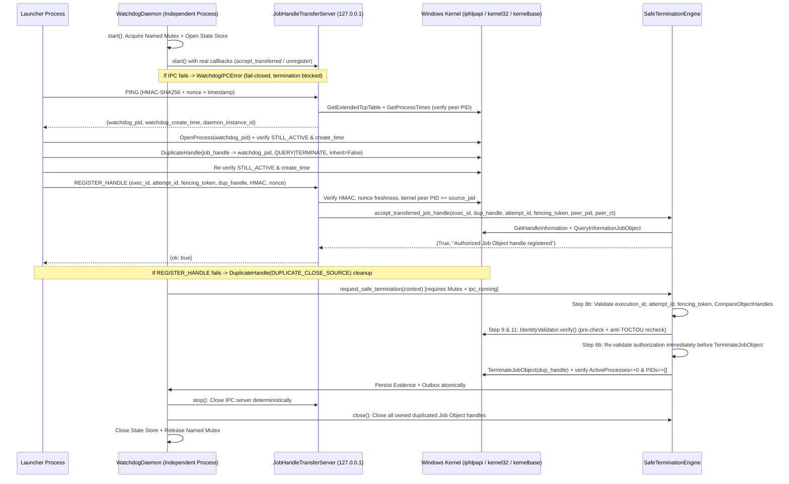

# DCF — Sprint 2.7 — Task 6: Rodada Corretiva Final (IPC Integration & Authorization Binding)

## 1. Resumo das Correções Implementadas

### 1.1 Integração Efetiva `WatchdogDaemon` ↔ `JobHandleTransferServer`
- **`WatchdogDaemon.start()`** ([watchdog_daemon.py](file:///c:/Users/User/.gemini/antigravity/scratch/dark-channel-factory/desktop_worker/watchdog/watchdog_daemon.py)):
  - Após adquirir o Windows Named Mutex (`Local\DCF_WATCHDOG_LOCK_<worker_id>`) e abrir o State Store, inicia o `JobHandleTransferServer` em loopback (`127.0.0.1`) conectado aos callbacks reais `_on_ipc_register_handle` → `SafeTerminationEngine.accept_transferred_job_handle()` e `_on_ipc_unregister_handle` → `SafeTerminationEngine.unregister_job_handle()`.
  - Falha na inicialização do servidor IPC marca `_ipc_started = False`, registra `IPC_SERVER_START_FAILED`, libera State Store e Mutex, e levanta `WatchdogIPCError`.
- **`WatchdogDaemon.request_safe_termination()`**:
  - Fail-closed: bloqueia qualquer solicitação de terminação caso o Mutex não seja detido ou caso `self.ipc_running` seja `False` (`WatchdogIPCError`), respeitando `_cycle_lock` e `_stop_event`.
- **`WatchdogDaemon.stop()`**:
  - Encerra o servidor IPC de forma determinística (`_stop_ipc_server()`), aguarda o ciclo ativo via `_cycle_lock`, fecha todos os handles duplicados de propriedade da engine (`termination_engine.close()`), fecha o State Store e libera o Mutex.
- **Reinicialização do Watchdog**:
  - Toda nova instância de `WatchdogDaemon` nasce com registro de autorização em memória vazio (fail-closed) e novo `daemon_instance_id`, bloqueando terminações até que o Launcher consulte o novo PID via `PING`, duplique o handle para a nova instância e registre a autorização.

### 1.2 Autenticação e Identidade Real do Cliente IPC
- **HMAC-SHA256 sem exposição de segredo** ([job_handle_transfer.py](file:///c:/Users/User/.gemini/antigravity/scratch/dark-channel-factory/desktop_worker/watchdog/job_handle_transfer.py)):
  - O `auth_token` nunca é transmitido em texto claro no payload JSON e nunca é gravado em logs (`__repr__` redigido como `<REDACTED>`).
  - Toda requisição é assinada com `HMAC-SHA256` sobre o payload canônico e verificada em tempo constante (`hmac.compare_digest`).
- **Proteção contra Replay**:
  - Toda requisição exige `nonce` criptográfico único e `timestamp` dentro da janela de frescor (`DEFAULT_MAX_REQUEST_AGE_SEC = 30.0s`). Nonces já observados são rejeitados com `replay_detected`.
- **Identidade Real do Processo Conectado (Kernel Windows)**:
  - O servidor **nunca confia** no `source_pid` informado pelo cliente.
  - Para cada conexão aceita, resolve o PID proprietário real do socket TCP local via `iphlpapi.GetExtendedTcpTable(TCP_TABLE_OWNER_PID_ALL)` e obtém o `process_create_time` via `OpenProcess(PROCESS_QUERY_LIMITED_INFORMATION)` + `GetProcessTimes`.
  - Se o cliente informar um `source_pid` divergente do PID real do kernel, a requisição é rejeitada imediatamente (`spoofed_source_pid`).
  - Suporta fixação opcional de `expected_launcher_pid` e `expected_launcher_create_time` para bloquear outros processos locais e reutilização de PID do Launcher.

### 1.3 Vínculo da Autorização à Tentativa (`AuthorizedJobHandle`)
- Cada autorização em memória vincula:
  - `execution_id`, `attempt_id`, `fencing_token`, `source_pid`, `source_process_create_time` e o `job_handle` validado como objeto de kernel Job Object (`QueryInformationJobObject`).
- Em `SafeTerminationEngine._validate_authorized_job_handle()` ([termination_engine.py](file:///c:/Users/User/.gemini/antigravity/scratch/dark-channel-factory/desktop_worker/watchdog/termination_engine.py)), executado tanto no pré-check (Step 8b) quanto na revalidação anti-TOCTOU imediatamente antes de `TerminateJobObject` (Step 6b):
  - Divergências em `execution_id`, `attempt_id` (`AUTHORIZED_ATTEMPT_MISMATCH`), `fencing_token` (`AUTHORIZED_FENCING_TOKEN_MISMATCH`), handle fechado/inválido ou objeto de kernel distinto (`CompareObjectHandles`) bloqueiam a operação com `IDENTITY_MISMATCH` ou `INCONCLUSIVE`.
  - Um handle autorizado para uma tentativa não pode ser reutilizado em outra tentativa da mesma execução.

### 1.4 Segurança do `DuplicateHandle` e Concorrência
- `PING` retorna `watchdog_pid`, `watchdog_create_time` e `daemon_instance_id`.
- `duplicate_job_handle_to_process()` valida que o processo destino está vivo (`GetExitCodeProcess == STILL_ACTIVE`) e possui o mesmo `process_create_time` **antes e depois** de `DuplicateHandle`, bloqueando reutilização de PID.
- Direitos mínimos estritos: `JOB_OBJECT_QUERY | JOB_OBJECT_TERMINATE` com `bInheritHandle=False` (rejeita qualquer acesso excedente).
- Falha entre `DuplicateHandle` e `REGISTER_HANDLE` (ou rejeição sem fechamento pelo servidor) dispara `close_remote_handle()` via `DuplicateHandle(..., DUPLICATE_CLOSE_SOURCE)` para eliminar vazamento de handle no Watchdog.
- **Concorrência entre revogação (`unregister_job_handle`), `close()` e `terminate_execution()`**:
  - A revogação remove imediatamente a entrada de `_authorized_job_handles` (fazendo o check anti-TOCTOU bloquear `TerminateJobObject`), mas adia o `CloseHandle` (`_deferred_close_handles`) até o `finally` de `terminate_execution()` caso a execução esteja ativa, impedindo uso de handle fechado ou reciclado.
- Nenhum valor numérico de `HANDLE` é persistido em SQLite ou disco.

---

## 2. Diagrama Atualizado: Comunicação Launcher ↔ WatchdogDaemon

